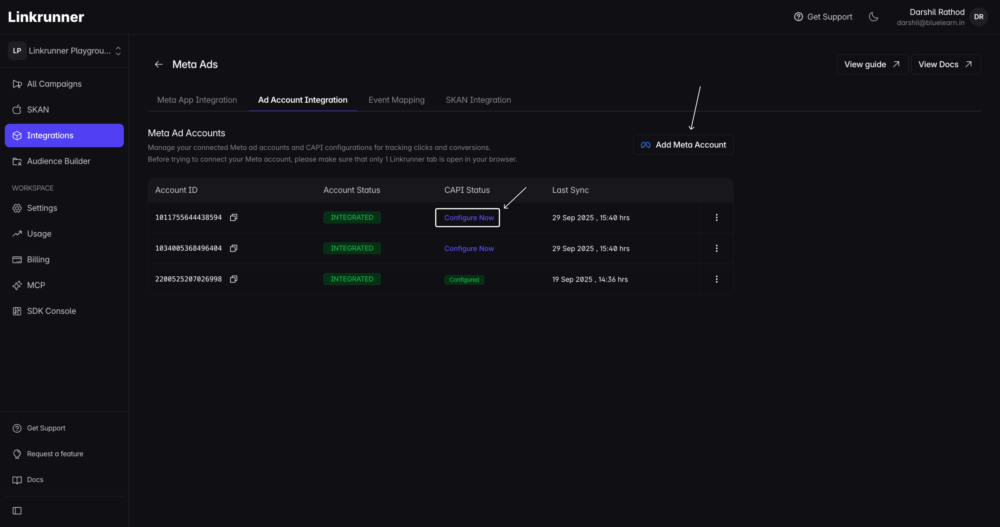
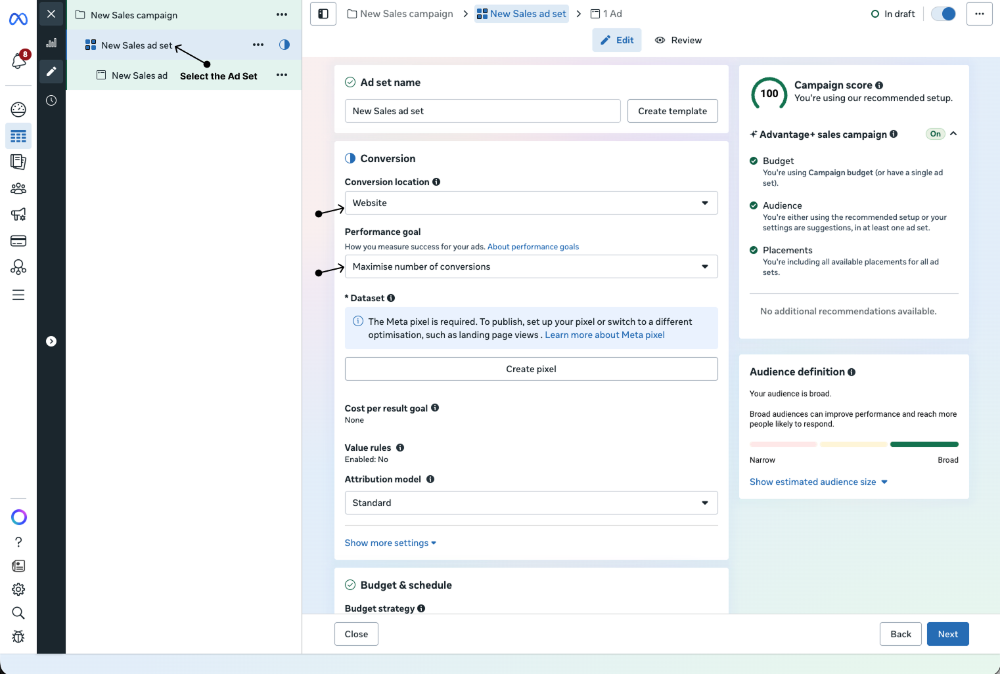
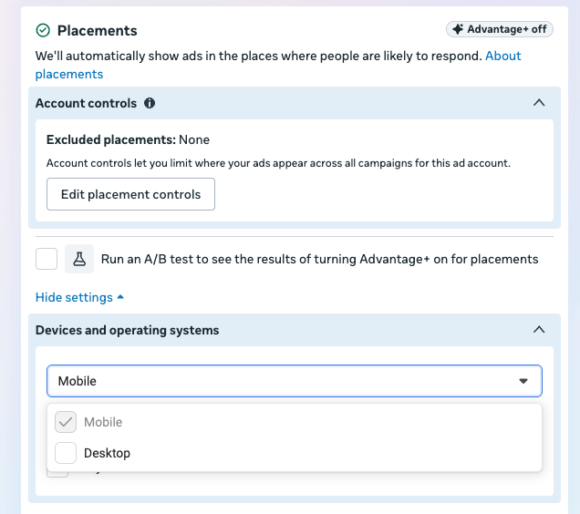
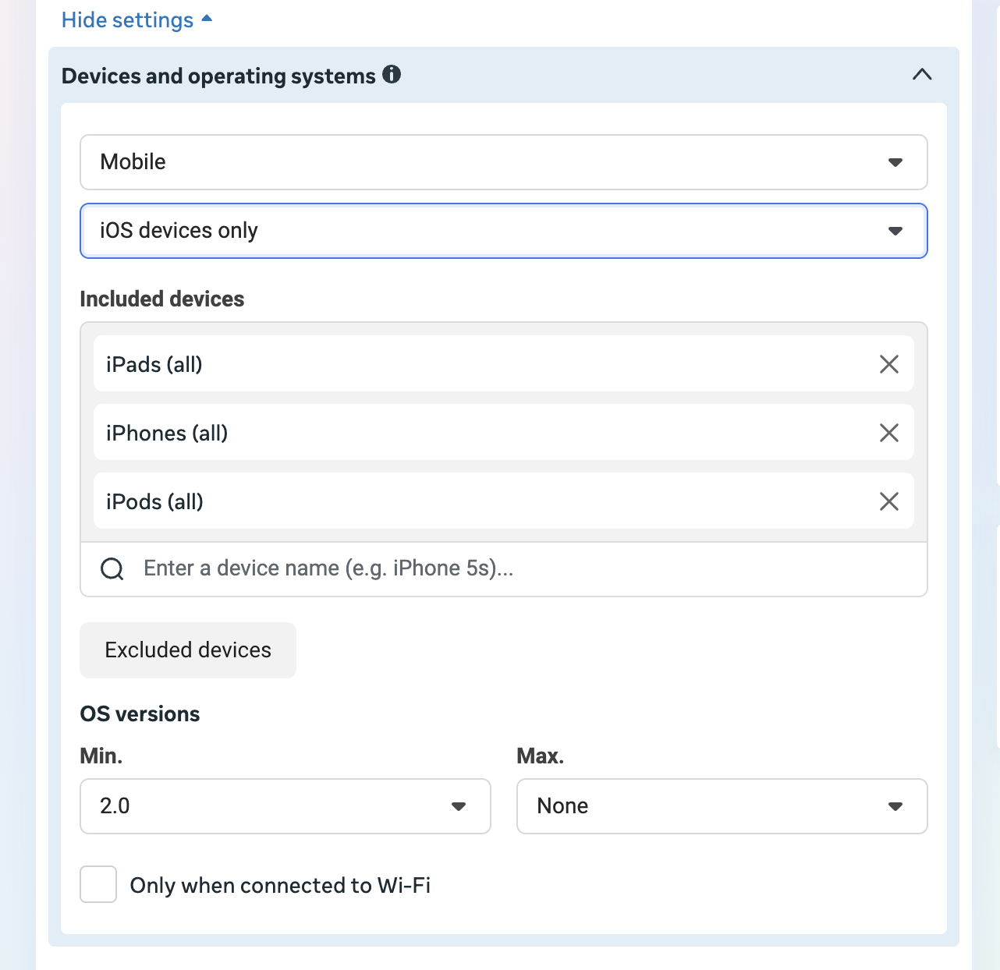
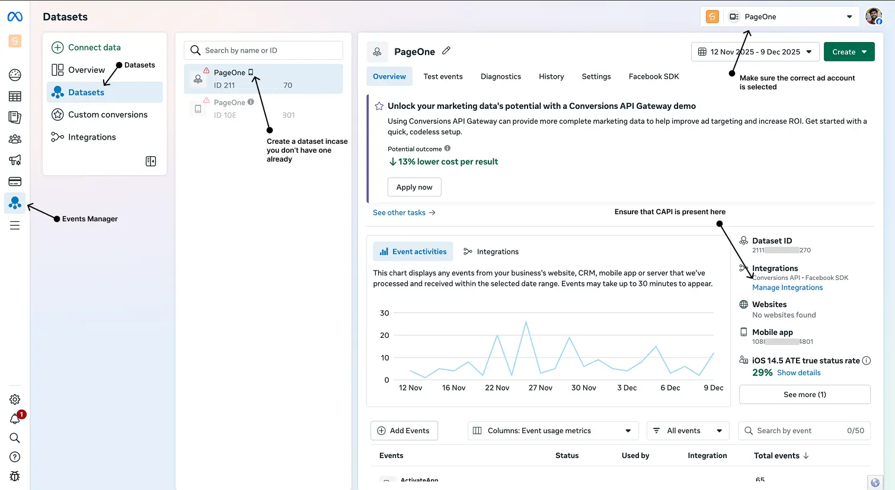
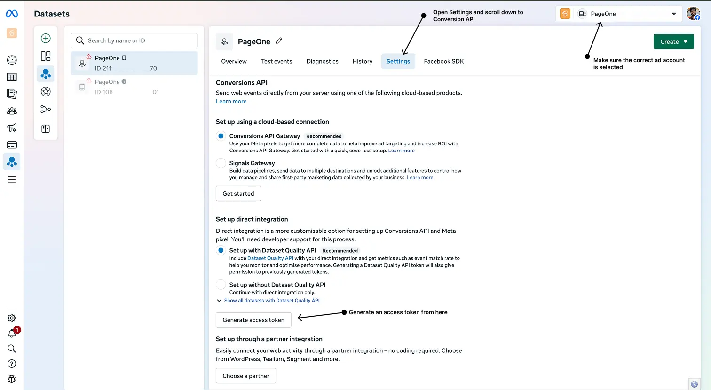

# Meta Web to App

<p class="vp-lead">Run Meta web-to-app ads for your app with advanced conversion tracking and optimization</p>

## Overview

Meta Web to App integration with Linkrunner lets you run app growth campaigns through Facebook and Instagram using a standard Sales (Website) objective, while Linkrunner handles attribution, spend sync, and CAPI event delivery. Linkrunner automatically creates one campaign per Meta Campaign on first click, so there is no manual campaign setup required on the Linkrunner side.

**Works for both Android and iOS apps.**

<video src="https://media.assets.linkrunner.io/web-to-app.mp4" controls autoplay loop muted playsinline style="max-height: 480px; width: 100%; border-radius: 8px"></video>

### What You'll Get

- **Web-to-app conversion tracking.** Track installs, sign-ups, purchases, and custom events from Meta ads.
- **Conversions API (CAPI) integration.** Enhanced tracking accuracy and resilience against browser limitations.
- **Deferred deep linking.** Drop users into the right screen after first open, even if they need to install the app first.
- **Cross-platform consistency.** Track installs across iOS and Android with one unified flow.
- **Automatic campaign creation.** Linkrunner mirrors your Meta Campaign hierarchy on first click, no manual setup needed.

### How It Works

A user taps your Meta ad, lands on your Linkrunner subdomain, and is routed to the App Store. Linkrunner tracks the click, matches it to the install, and attributes the campaign.

<video src="https://media.assets.linkrunner.io/meta-web-to-app-flow.mp4" controls autoplay loop muted playsinline style="width: 100%; border-radius: 8px"></video>

## Setup

<Steps>

<Step title="Connect your Meta ad account">

Connect your Meta advertising account with Linkrunner to enable spend sync and CAPI event delivery. This is the same OAuth connection used for Meta App Ads.

1. Go to [Linkrunner Settings → Meta Integration](https://dashboard.linkrunner.io/settings?s=meta-integration&meta_tab=meta-ad-account)
2. Click **"Add account"**
3. Log in with your Facebook account credentials and grant the requested permissions



<Note>

Linkrunner needs access to your Meta ad account to pull spend data from the Marketing API and to send CAPI conversion events back to Meta. Without this connection, cost and ROAS figures will not appear in your Linkrunner dashboard.

</Note>

</Step>

<Step title="Add your Linkrunner domain">

Linkrunner uses your sub-domain as the destination URL in your Meta ads. If you have not set one up yet, go to [Settings → Domains](https://dashboard.linkrunner.io/settings?s=domains) and claim a Linkrunner sub-domain, or add a Branded sub-domain.

For both options, see [Set up your link domain](/features/subdomain-setup).

Once your sub-domain is active (for a Branded sub-domain, CNAME verified and SSL active), you are ready for the next step. You can also find your ready-to-paste destination URL under [Integrations → Meta Ads → Web to App](https://dashboard.linkrunner.io/dashboard/integrations/meta-ads?tab=web_to_app).

</Step>

<Step title="Set the destination URL in your Meta ad">

In Meta Ads Manager, paste your Linkrunner destination URL directly as the ad's **Website URL** (in the ad destination section, not the Tracking field).

Use this template, replacing `<your-linkrunner-domain>` with your actual subdomain:

```
https://<your-linkrunner-domain>/?utm_source=facebook&utm_medium=paid_social&campaign_id={{campaign.id}}&adset_id={{adset.id}}&ad_id={{ad.id}}&placement={{placement}}&site_source={{site_source_name}}
```

Meta substitutes the `{{...}}` macros with real campaign, ad set, ad, and placement IDs at delivery time. Linkrunner reads those values on each click to:

1. **Auto-create a Linkrunner campaign** mirroring your Meta Campaign on first click. No manual campaign creation is needed.
2. **Sync Meta spend** into your Linkrunner dashboard. The `campaign_id` macro is what the spend sync uses to pull cost data from Meta's Marketing API.
3. **Break out reports by ad set, ad, and placement** using `adset_id`, `ad_id`, `placement`, and `site_source`.

<Note>

A ready-to-paste version of this URL (with your subdomain pre-filled) is available under [Integrations → Meta Ads → Web to App](https://dashboard.linkrunner.io/dashboard/integrations/meta-ads?tab=web_to_app). Pick the destination domain there and copy the URL directly.

</Note>

<Warning>

Paste this URL as the **Website URL** in the ad destination section, not into the Tracking field. Without the `campaign_id` macro in the destination URL, Meta spend will not sync into Linkrunner reports and campaign-level breakdowns will be missing.

</Warning>

**How to configure the ad in Meta Ads Manager:**

1. Go to [Meta Ads Manager](https://business.facebook.com/adsmanager) and create or edit a campaign

2. Set the campaign objective to **Sales**

3. In the ad set, set **Conversion location** to **Website**, **Performance goal** to **Maximise number of conversions**, and select your **Dataset** (Meta pixel)

   

4. Select an ad set and go to **Placements → Show more settings → Devices and operating systems**. Select **Mobile** only and leave **Desktop** unselected.

   

   For an iOS campaign, select **iOS devices only** in the operating-system dropdown. Selecting **Mobile** alone still includes Android devices.

   Under **Included devices**, keep only the devices your app supports. For an iPhone-only app, keep **iPhones (all)** and remove **iPads (all)** and **iPods (all)**. Set **OS versions → Min.** to your app's minimum supported iOS version, rather than copying the value in the screenshot.

   

   Check that each ad set targets only devices and operating systems your app supports before publishing. Keep **Conversion location** set to **Website**; iOS is the device-targeting choice, not the conversion location.

5. In the ad, paste the destination URL above as the **Website URL**

6. Add your creative assets and publish

<Note>

Even though the conversion location is set to Website, the Linkrunner link automatically redirects mobile users to your app. Meta treats it as a website click and Linkrunner handles the redirect to the appropriate app store or directly into the app.

</Note>

</Step>

</Steps>

## Set Up Conversions API for Event Sending

Linkrunner sends Web to App conversions to Meta only through the Conversions API. Without a saved **Dataset ID** and access token, no install, sign-up, or in-app event reaches Meta, and you have nothing to optimize on.

### Generate an Access Token

Complete the access token setup in Facebook Events Manager:





1. Navigate to [Facebook Events Manager](https://business.facebook.com/events_manager2/list)
2. Follow the [CAPI token generation steps](/ad-networks/meta-ads#2-generate-access-token) as shown in the Meta Ads setup guide
3. Paste the token into your Linkrunner [Meta Integration settings](https://dashboard.linkrunner.io/settings?s=meta-integration)

<Tip>

Keep your access token secure and never share it publicly. This token provides access to your Meta advertising data.

</Tip>

## Events Linkrunner sends to Meta

For users who tap a Web to App ad, Linkrunner sends these events to your dataset as website events. Each one carries the ad click URL and the click ID from `fbclid`, so Meta can match it to the ad click.

| When it happens | Event in your dataset |
| --- | --- |
| The user opens the app for the first time | `Download` |
| The user signs up | `CompleteRegistration` |
| Purchases and other mapped events | The Meta event name you chose in [Event Mapping](https://dashboard.linkrunner.io/dashboard/integrations/meta-ads?tab=event_mapping) |

`CompleteRegistration` and `Purchase` are Meta standard events, so you can pick them directly as the ad set's conversion event. `Download` is not a standard website event, so Ads Manager does not list it. To optimize for installs, create a custom conversion on it.

### Optimize for installs with a custom conversion

Meta lets you build a custom conversion only on an event your dataset has already received. Send a test first:

1. On the [Event Mapping tab](https://dashboard.linkrunner.io/dashboard/integrations/meta-ads?tab=event_mapping), click the paper plane **Send event to ad network** icon on the **Mobile App Install** row. This sends a test `Download` website event to your dataset.
2. In Meta Events Manager, open your dataset and check that `Download` appears. If it shows **Blocked by Meta**, see [Download is blocked by Meta](#download-is-blocked-by-meta).
3. Create a custom conversion with the event `Download` and a **URL contains** rule for each link domain you use in your Meta ads, written in full, for example `link.yourapp.com`. Real installs carry the domain of the link the user tapped. Linkrunner's test events use a different domain, so the rule keeps them out of your conversion count.
4. In the ad set, select the custom conversion as the conversion event.

## Why Run Meta Web to App Ads?

Running Meta web-to-app ads gives you more flexibility and control over your campaigns:

- **Better attribution.** CAPI provides server-side tracking that is more reliable than browser-based tracking.
- **Cross-platform reach.** Run campaigns across Facebook, Instagram, Messenger, and Audience Network.
- **Advanced optimization.** Meta's algorithm can optimize based on your actual in-app conversion events.
- **Deferred deep linking.** Users land on the right content inside your app after installation.
- **iOS 14.5+ compatibility.** Enhanced tracking that works within iOS privacy constraints.

## Important Notes

<Note>

After connecting your Meta account and running the first click, it may take a few hours for conversion data to start flowing from Linkrunner to Meta. This is normal processing time.

</Note>

<Note>

Automatic Meta app-link sync is for Meta App Promotion campaigns. For Meta Web to App, keep using the Linkrunner destination URL as the ad **Website URL**.

</Note>

<Tip>

Start with simple conversion events like app installs or sign-ups before optimizing for more complex events like purchases. This gives Meta's algorithm time to learn and gather sufficient data.

</Tip>

## Troubleshooting

### Conversions Not Tracking

- Verify your Meta account is properly connected in Linkrunner Settings → Meta Integration
- Ensure CAPI is configured correctly in Facebook Events Manager
- Check that your access token is valid and has not expired
- Confirm your app is sending events to the Linkrunner SDK

### Download is not showing in Events Manager

Work through these checks in order:

1. **No Web to App install has happened yet.** Linkrunner sends `Download` only when a user opens your app for the first time after tapping a Web to App ad. To see one before launch, click the paper plane **Send event to ad network** icon on the **Mobile App Install** row of the [Event Mapping tab](https://dashboard.linkrunner.io/dashboard/integrations/meta-ads?tab=event_mapping).
2. **You are checking the Test events tab.** Linkrunner's test is sent as a normal event without a Meta test event code, so it does not appear under **Test events**. Look for it on the dataset's **Overview** instead.
3. **Meta is holding it for review.** If your dataset has data sharing restrictions, `Download` shows as **Blocked by Meta** until you confirm it. See [Download is blocked by Meta](#download-is-blocked-by-meta).
4. **Conversions API is not set up for that ad account.** Linkrunner sends `Download` only through the Conversions API. On the [Ad Account tab](https://dashboard.linkrunner.io/dashboard/integrations/meta-ads?tab=ad_account), check that the ad account running the campaign has a **Dataset ID** and access token saved, and that your ad set uses the same dataset.
5. **The install was not credited to your Web to App campaign.** Linkrunner sends `Download` only for installs attributed to a Meta Web to App campaign. If the campaign is missing in Linkrunner, see [Campaign not appearing in Linkrunner dashboard](#campaign-not-appearing-in-linkrunner-dashboard).

### Download is blocked by Meta

Meta puts some datasets under data sharing restrictions based on the business category, for example finance or health. Events Manager then shows **Data sharing restrictions applied** on the **Overview** page. With any restriction in place, Meta blocks every custom event, including `Download` and any custom event name you map, until you confirm it. A blocked event cannot be used in a custom conversion or a campaign.

To confirm `Download`:

1. In Meta Events Manager, open **Overview**.
2. Under **Confirm custom event(s) that belong to you**, click **Review events** and acknowledge Meta's terms.

   

3. On the **Action required** tab, select `Download` and confirm it.

   

4. Send another test from the **Mobile App Install** row so the event shows as active.

Standard events such as `CompleteRegistration` and `Purchase` do not need this review. Under **core setup**, Meta also removes everything after the domain from event URLs, so build custom conversion URL rules on your link domains only.

### Campaign Not Appearing in Linkrunner Dashboard

Linkrunner auto-creates a campaign on the first click that carries a valid `campaign_id` in the destination URL. If no campaign appears after the first click:

- Verify the destination URL includes `campaign_id={{campaign.id}}` with the correct macro syntax
- Check that the URL is pasted as the **Website URL** (not the Tracking field)
- Make sure your sub-domain is active (for a Branded sub-domain, CNAME verified and SSL active)

### Spend Not Syncing

- Confirm the `campaign_id` macro is present in the destination URL
- Verify the Meta ad account connected in Linkrunner matches the account running the campaign
- Allow up to a few hours for the first spend data to appear after campaign launch

---

For any questions or assistance with Meta Web to App integration, please contact us at <support@linkrunner.io>.
