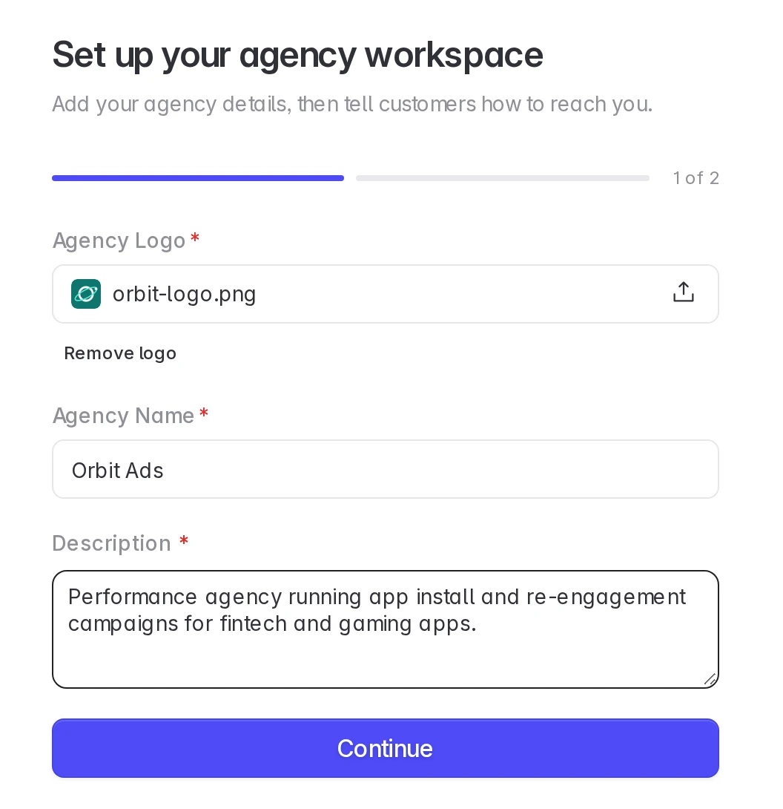
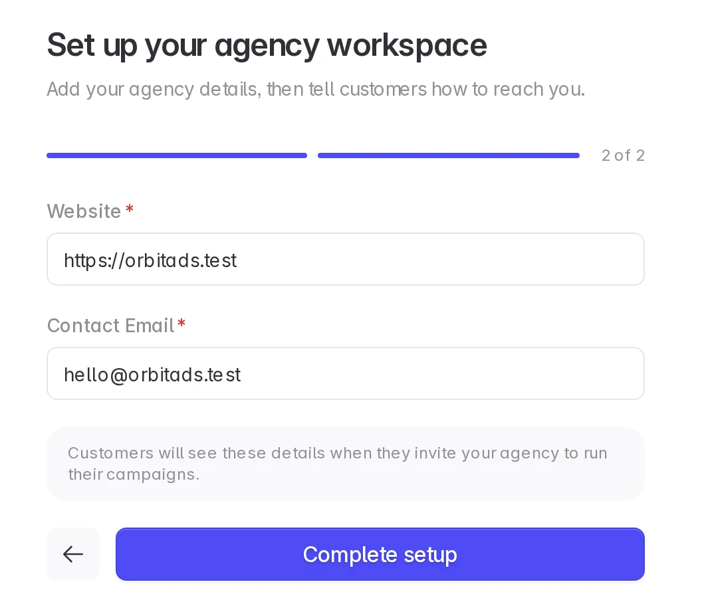
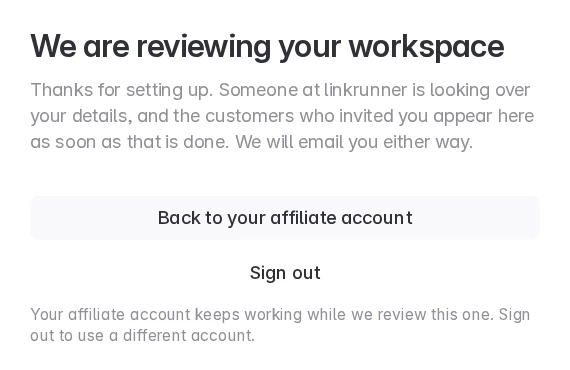
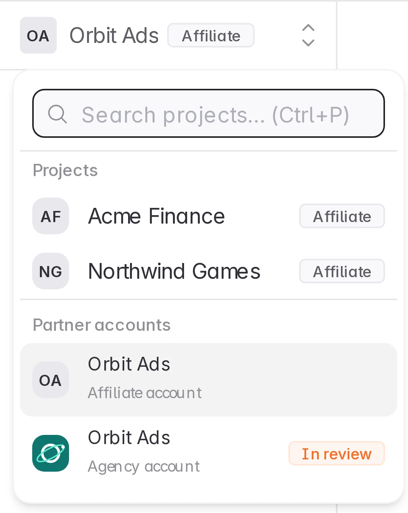
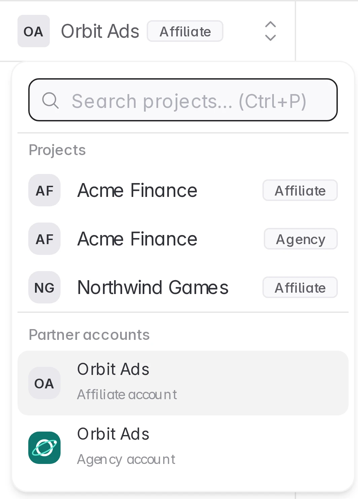
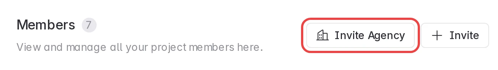
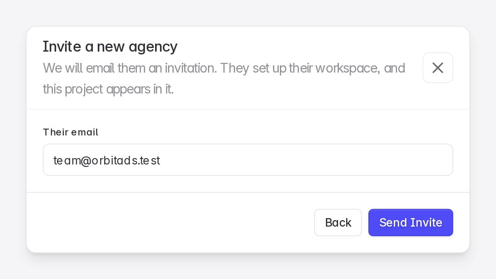
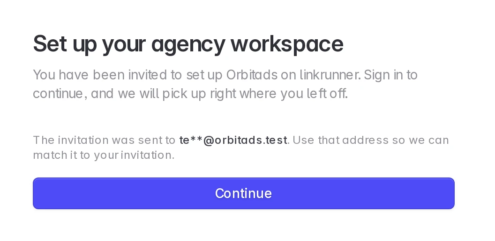

# Add an Agency Account

Run campaigns for customers as an agency from the same login you use as an affiliate

If you send traffic to Linkrunner customers as an affiliate and also run campaigns for them as an agency, you can do both from one login. You get a second workspace for the agency work and switch between the two from the project picker.

<Info>

You need an affiliate account and your agency details: a logo, name, description, website, and contact email. You do not need a customer invitation.

</Info>

## Affiliate and agency accounts stay separate

|                 | Affiliate account                           | Agency account                                |
| --------------- | ------------------------------------------- | --------------------------------------------- |
| What it is for  | Traffic from your own network               | Campaigns you run inside a customer's project |
| Attribution     | Installs credited to your affiliate network | Campaigns created by your agency              |
| Customer access | Set on your affiliate connection            | Set on your agency connection                 |
| Team            | Members of your affiliate workspace         | Members of your agency workspace              |

A customer who works with you both ways sees two connections and gives each its own access. Your affiliate and agency data are never merged.

## 1. Open Add an agency account

Open the project picker at the top of the sidebar. Under **Partner accounts**, click **Add an agency account**. It opens the agency sign up page.

The option is there while your login has no agency account. Once you have one, it is listed under **Partner accounts** instead.

## 2. Create your agency workspace

The page shows the email you are signed in with. Your agency account uses the same login as your affiliate account. Click **Create agency workspace**.

If a customer has already invited your email as an agency, the page tells you to use that invitation instead. See [Use a customer invitation instead](#use-a-customer-invitation-instead).

## 3. Add your agency details

Upload a logo, enter your agency name and a description, then add your website and contact email. Click **Complete setup**. The fields are the same as for any new agency, see [Create an agency account](/agency-partners/sign-up#4-add-your-agency-details).

## 4. Wait for review

Linkrunner reviews the new agency workspace. Your affiliate account keeps working in the meantime. Click **Back to your affiliate account** to return to it.

You get an email when the review is done.

After approval, customers can find your agency in their agency list and engage you. See [Get engaged by customers](/agency-partners/sign-up#6-get-engaged-by-customers).

## 5. Switch between your accounts

Open the project picker at the top of the sidebar. **Partner accounts** lists both workspaces. Click one to open it. While the agency workspace is under review, it shows **In review**.

When a customer has connected both your affiliate and your agency to the same project, that project appears twice in the picker, once tagged **Affiliate** and once tagged **Agency**. Each row opens the project with that account's access.

## Use a customer invitation instead

A customer can also invite you from **Settings → Members → Invite Agency → Invite them by email**. Ask them to use the **same email address you sign in with as an affiliate**. See [Invite an agency](/agency-partners/invite-an-agency) for their steps.

Open the link in the invitation email. If you are already signed in to Linkrunner, you go straight to the agency setup. Otherwise sign in with the invited address first. Then add your agency details as in step 3. The inviting customer's project appears in your agency workspace once it is approved.

## Troubleshooting

**"You already have an agency invitation".**
A customer has already invited your email as an agency. Open that invitation email and use its link, so your agency workspace is connected to that customer.

**"This invitation belongs to a different email".**
The invitation was sent to another address. Ask the customer to invite the email you sign in with, or sign out and sign in with the invited address.

**The invitation link expired.**
Invitations are valid for 14 days. Ask the customer to send a new one.

**Your agency workspace was not approved.**
Your affiliate account is not affected. Contact <support@linkrunner.io> if you think it is a mistake.

**Need help?** Contact <support@linkrunner.io>
