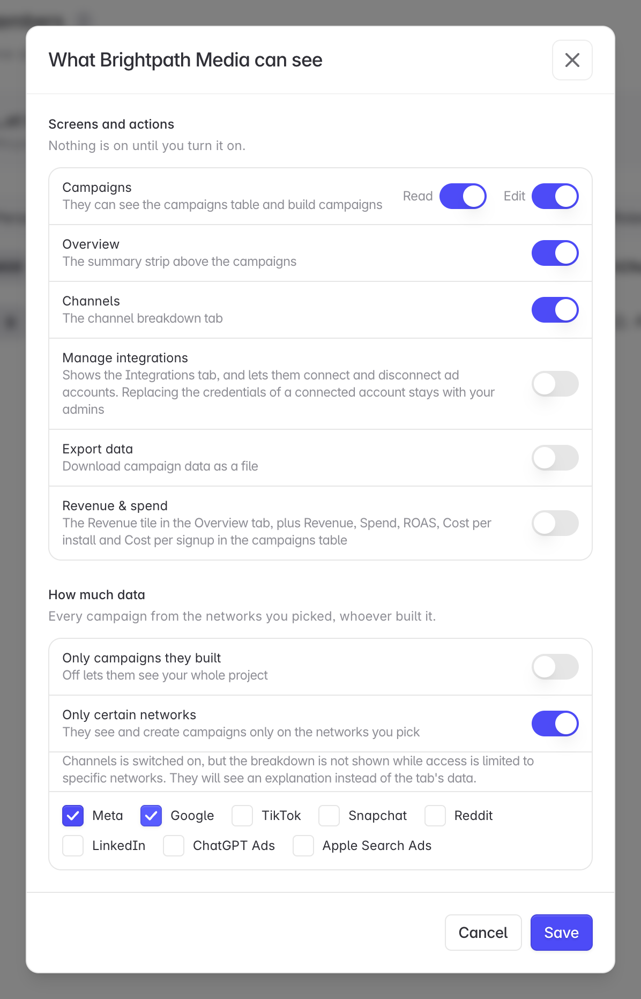

# Control Agency Access

Choose which screens, actions, and data an agency can reach inside your project

An engaged agency starts with nothing. You decide, per agency, which screens they open, which actions they take, and how much of your project they measure. App campaigns and Web campaigns are set separately, so an agency can run your app installs without seeing your website, or the other way round.

The panel comes to you when you connect an agency, and the sliders icon on their row in **Settings → Members** opens it again whenever you want to change your mind.

<Info>

Only project admins can change agency access.

</Info>

## 1. Open the access panel

Open **Settings → Members**. Agencies appear underneath your people, marked **Agency**. A badge next to it shows which side they work on: **App**, **Web**, or **App + Web**. No badge means they cannot see any campaigns yet.

Click the sliders icon on the agency's row. The bin next to it ends the engagement. See [Invite an Agency](/agency-partners/invite-an-agency) for that.

The panel also opens by itself the moment you connect an agency from **Integrations → Agencies**, so a new engagement never waits for someone to come back to it. [Invite an Agency](/agency-partners/invite-an-agency) covers that route.

## 2. Choose their screens and actions

The top of the panel is **Manage integrations**, then a switch between **App campaigns** and **Web campaigns**. Each tab has its own switches and its own data scope. A new engagement has all of them off.

| Tab               | When you see it                                     |
| ----------------- | --------------------------------------------------- |
| **App campaigns** | Your project has an app store link.                 |
| **Web campaigns** | Web campaigns are turned on for your project.       |

A project with only one of them shows that side alone, without the switch.

### Manage integrations

**Manage integrations** sits above both tabs because ad accounts are shared between App and Web campaigns. It shows the agency the Integrations tab and lets them connect and disconnect ad accounts. Replacing the credentials of an account that is already connected stays with your admins.

It does not need **Read** on either side.

### App campaigns

| Switch                     | What it gives them                                                                                                                 |
| -------------------------- | ---------------------------------------------------------------------------------------------------------------------------------- |
| **App campaigns · Read**   | The App campaigns table. Everything below depends on this.                                                                          |
| **App campaigns · Edit**   | Creating and changing App campaigns. Turning **Edit** on turns **Read** on.                                                        |
| **Overview**               | The summary strip above the campaigns.                                                                                             |
| **Channels**               | The channel breakdown tab.                                                                                                         |
| **Export data**            | Downloading campaign data as a file.                                                                                               |
| **Revenue & spend**        | The Revenue tile in Overview, plus the Revenue, Spend, ROAS, Cost per install, and Cost per signup columns in the campaigns table. |

### Web campaigns

| Switch                     | What it gives them                                                                     |
| -------------------------- | -------------------------------------------------------------------------------------- |
| **Web campaigns · Read**   | The Web campaigns table. Everything below depends on this.                              |
| **Web campaigns · Edit**   | Creating and changing Web campaigns. Turning **Edit** on turns **Read** on.            |
| **Export data**            | Downloading the Web campaigns table as a file. User lists stay with your team.         |
| **Revenue & spend**        | The Revenue, Spend, and ROAS columns for their Web campaigns.                          |

**Read governs the rest of its tab.** With **App campaigns · Read** off, every App switch below it is disabled, and the same goes for **Web campaigns · Read** on the Web tab. Turning one side on does not turn on the other.

## 3. Choose how much data

The bottom of each tab narrows what that side's screens are allowed to show. App and Web keep separate settings, so you can limit one without touching the other.

**Only campaigns they built.** On, the agency sees and measures only the campaigns their own agency created on that side. Off, they get every campaign on that side, including ones your team and your other partners built.

**Only certain networks.** On, the agency sees campaigns only on the networks you tick. On the App tab they can also create campaigns only on those networks. Pick at least one, or turn the control off. A restriction with nothing ticked would show them nothing at all, so Linkrunner refuses to save it.

<Note>

**Channels and a network restriction do not combine.** The channel breakdown cannot be limited to named networks yet, so an agency with both gets an explanation in the Channels tab instead of the breakdown. The panel says so when you pick the combination. Leave **Channels** off, or leave the network restriction off, if the tab matters to them.

</Note>

## 4. Save

Click **Save**. Both tabs are saved together. The change applies straight away, though an agency with the screen already open needs to refresh it, and a change can take up to 30 seconds to reach every Linkrunner server.

## What the agency sees when a switch is off

Nothing is hidden silently. A screen you have not granted tells the agency that the customer has not given them access to it, so they know to ask you. The same holds for a campaign outside the scope you set and for a network you did not tick.

## Troubleshooting

**The sliders icon is missing from the agency's row.**
You need to be an admin on the project.

**The Web campaigns tab is missing.**
Web campaigns are not turned on for your project. The panel only shows the sides your project uses.

**The agency still cannot see a screen you turned on.**
Ask them to refresh. If it persists, check that **Read** is on for the tab that screen belongs to. App and Web each have their own.

**The agency can see App campaigns but not Web campaigns.**
**Web campaigns · Read** is off. Open the **Web campaigns** tab and turn it on.

**The agency's Channels tab is empty, with an explanation.**
**Only certain networks** is on for App campaigns. The channel breakdown is not shown while access is limited to named networks.

**The agency sees campaigns your team built.**
**Only campaigns they built** is off on that tab. Turn it on to limit them to their own work.

**Save is greyed out.**
**Only certain networks** is on with no network ticked, on the App or the Web tab. Tick at least one, or turn the control off.

**Need help?** Contact <support@linkrunner.io>
