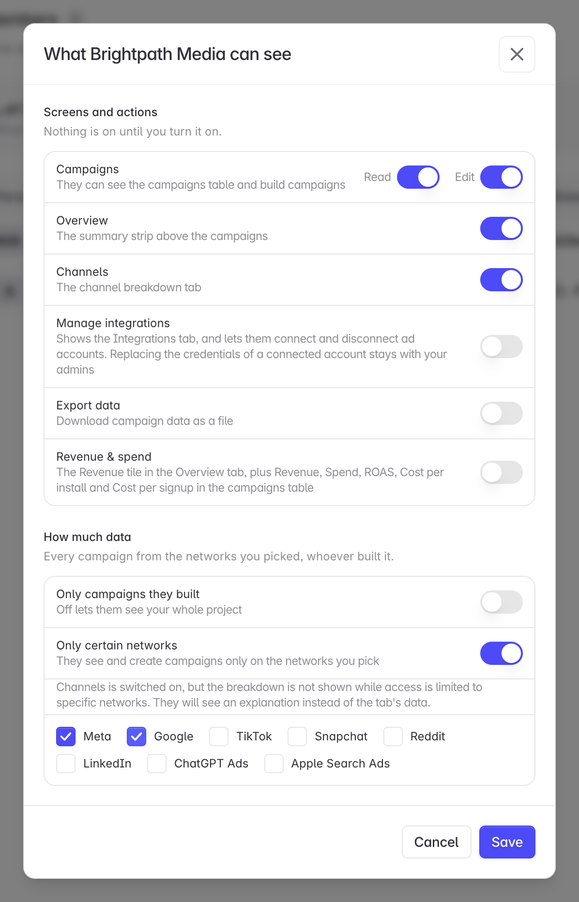

# Control Agency Access

Choose which screens, actions, and data an agency can reach inside your project

A new agency starts with every switch off, **Sign-ups** included. You decide, per agency, which screens they open, which actions they take, and how much of your project they measure. App campaigns and Web campaigns are set separately, so an agency can run your app installs without seeing your website, or the other way round.

The panel comes to you when you connect an agency, and the sliders icon on their row in **Settings → Members** opens it again whenever you want to change your mind. To change one switch for every agency at once, see [Change one switch for all agencies](#change-one-switch-for-all-agencies).

<Info>

Only project admins can change agency access.

</Info>

## 1. Open the access panel

Open **Settings → Members**. Agencies appear underneath your people, marked **Agency**. A badge next to it shows which side they work on: **App**, **Web**, or **App + Web**. No badge means they cannot see any campaigns yet.

Click the sliders icon on the agency's row. The bin next to it ends the engagement. See [Invite an Agency](/agency-partners/invite-an-agency) for that.

The panel also opens by itself the moment you connect an agency from **Integrations → Agencies**, so a new engagement never waits for someone to come back to it. [Invite an Agency](/agency-partners/invite-an-agency) covers that route.

## 2. Choose their screens and actions

The top of the panel is **Manage integrations**, then a switch between **App campaigns** and **Web campaigns**. Each tab has its own switches and its own data scope. A new engagement has every switch off, **Sign-ups** included. Agencies you engaged earlier keep the switches they already have, so nothing changes for them until you change it.

| Tab               | When you see it                                     |
| ----------------- | --------------------------------------------------- |
| **App campaigns** | Your project has an app store link.                 |
| **Web campaigns** | Web campaigns are turned on for your project.       |

A project with only one of them shows that side alone, without the switch.

### Manage integrations

**Manage integrations** sits above both tabs because ad accounts are shared between App and Web campaigns. It shows the agency the Integrations tab and lets them connect and disconnect ad accounts. Replacing the credentials of an account that is already connected stays with your admins.

It does not need **Read** on either side.

### App campaigns

| Switch                     | What it gives them                                                                                                                 |
| -------------------------- | ---------------------------------------------------------------------------------------------------------------------------------- |
| **App campaigns · Read**   | The App campaigns table. Everything below depends on this.                                                                          |
| **App campaigns · Edit**   | Creating and changing App campaigns. Turning **Edit** on turns **Read** on.                                                        |
| **Overview**               | The summary strip above the campaigns.                                                                                             |
| **Channels**               | The channel breakdown tab.                                                                                                         |
| **Export data**            | Downloading campaign data as a file. With **User lists** on, user files too.                                                       |
| **User lists**             | The **Users** tab, and the user rows in a campaign's drawer, for people who signed up through their campaigns. Needs **Read** and **Sign-ups**. |
| **Include device IDs**     | GAID and IDFA in the user files they download from a drawer. Greyed out until **User lists** is on, and turning **User lists** off turns it off. |
| **Sign-ups**               | Sign-ups, Conversion and Cost per sign-up in the campaigns table and drawer, the Overview sign-up tiles, and sign-up figures in Channels. Needs **Read**. Off hides them, and the user lists too, since they need **Sign-ups** on. |
| **Revenue & spend**        | The Revenue tile in Overview, plus the Revenue, Spend, ROAS, Cost per install, and Cost per signup columns in the campaigns table. |

### Web campaigns

| Switch                     | What it gives them                                                                     |
| -------------------------- | -------------------------------------------------------------------------------------- |
| **Web campaigns · Read**   | The Web campaigns table. Everything below depends on this.                              |
| **Web campaigns · Edit**   | Creating and changing Web campaigns. Turning **Edit** on turns **Read** on.            |
| **Export data**            | Downloading the Web campaigns table as a file. With **User lists** on, user files too. |
| **User lists**             | The **Users** tab for web users whose first visit came through their Web campaigns. Needs **Read** and **Sign-ups**. |
| **Sign-ups**               | Sign-ups, unique users and Conversion for their Web campaigns. Needs **Read**. Off hides sign-up events from their web campaigns, drawer and exports, and the user list too, since it needs **Sign-ups** on. |
| **Revenue & spend**        | The Revenue, Spend, and ROAS columns for their Web campaigns.                          |

**Sign-ups does not turn Read on.** It only takes effect once **Read** is on for that tab. Postbacks don't change when you turn it off.

<Note>

**Sign-ups** is separate from the affiliate [**Show sign-ups**](/affiliate-partners/hide-sign-ups) switch. A company connected to your project both as an affiliate partner and as an agency has two separate settings. To hide sign-ups from it completely, turn off both.

</Note>

**Read governs the rest of its tab.** With **App campaigns · Read** off, every App switch below it is disabled, and the same goes for **Web campaigns · Read** on the Web tab. Turning one side on does not turn on the other.

### User lists and user files

**User lists** gives the agency a **Users** tab in its sidebar. It lists your users who came through campaigns the agency can see, so **Only campaigns they built** and **Only certain networks** limit it too. App users are the people who signed up through those campaigns. Web users are the people whose first visit came through them. Each row shows the user's details, such as ID, name, email and phone. The agency can filter by date and, on the App side, by campaign. It has no search, no channel column, no user detail page and no cohorts.

A side's list shows only when **Read**, **User lists** and that side's **Sign-ups** are all on. Turning **Sign-ups** off keeps **User lists** on, but the list stops showing.

**User files** are the **Export** button on the **Users** tab and, on the App side, the download menu in a campaign, ad set or creative drawer (**All Onboarded Users** and **Paying Users**). They need **Export data** on the same side as well. **Export data** alone only downloads the campaigns table.

- **Include device IDs** adds GAID and IDFA to the files from a drawer. Without it they are left out.
- **Paying Users**, and the revenue columns in the other drawer files, need **Revenue & spend**.

<Note>

User lists and user files include your users' names, emails and phone numbers, so turn them on only for agencies you trust with that.

</Note>

## 3. Choose how much data

The bottom of each tab narrows what that side's screens are allowed to show. App and Web keep separate settings, so you can limit one without touching the other.

**Only campaigns they built.** On, the agency sees and measures only the campaigns their own agency created on that side. Off, they get every campaign on that side, including ones your team and your other partners built.

**Only certain networks.** On, the agency sees campaigns only on the networks you tick. On the App tab they can also create campaigns only on those networks. Pick at least one, or turn the control off. A restriction with nothing ticked would show them nothing at all, so Linkrunner refuses to save it.

<Note>

**Channels and a network restriction do not combine.** The channel breakdown cannot be limited to named networks yet, so an agency with both gets an explanation in the Channels tab instead of the breakdown. The panel says so when you pick the combination. Leave **Channels** off, or leave the network restriction off, if the tab matters to them.

</Note>

## 4. Save

Click **Save**. Both tabs are saved together. The change applies straight away, though an agency with the screen already open needs to refresh it, and a change can take up to 30 seconds to reach every Linkrunner server.

## What the agency sees when a switch is off

Nothing is hidden silently. A screen you have not granted tells the agency that the customer has not given them access to it, so they know to ask you. The same holds for a campaign outside the scope you set and for a network you did not tick.

## Change one switch for all agencies

To set the same switch for every agency at once, open **Settings → Members** and click **Access for all agencies**, next to **Invite Agency**. Only project admins see it, and only once your project has at least one agency.

1. Open the list that says **Choose a switch** and pick one. When your project has App and Web campaigns, the list is grouped under **App** and **Web**. **Include device IDs**, **Manage integrations** and **Attribution windows** are not in it, because you set those for each agency on its own.
2. Choose **On** or **Off**. **Off** is selected to start with.
3. Read the preview. Nothing is saved yet. It lists the agencies that gain or lose the switch, then the ones that are **Skipped**, each with its reason. An agency that is still being invited, is suspended, or that you disconnected carries a tag: **Invited**, **Suspended**, or **Disconnected**.
4. Click the button at the bottom, which names what it will do, such as **Turn Sign-ups off for 5 agencies**. While nothing would change it reads **Apply** and stays greyed out.

When it saves, the dialog closes and a message says how many agencies changed and how many were left as they are. Agencies see the change on their next page load. To change one agency, use the sliders icon on its row.

What the preview tells you:

- **On never turns another switch on.** An agency that needs one first is skipped, and the reason names it, such as "Needs Campaigns on first." **Campaigns** is this list's name for App **Read**, and **Web campaigns** is its name for Web **Read**. A note also says when the switch will not show yet, such as "Needs Sign-ups on to show." for **User lists**.
- **Off also turns off the switches that depend on it.** The note under an agency names them, such as "Also turns off Overview and Channels." Turning **Sign-ups** off leaves **User lists** on, and the note says the user lists stop too.
- **On reaches connected agencies only.** Agencies you disconnected are skipped.
- **Off reaches disconnected agencies too.** The switch stays off if you reconnect them, and the note says so.

<Warning>

Turning a switch off takes effect right away. Tell the agencies first if they rely on it.

</Warning>

## Troubleshooting

**The sliders icon is missing from the agency's row.**
You need to be an admin on the project.

**The Web campaigns tab is missing.**
Web campaigns are not turned on for your project. The panel only shows the sides your project uses.

**The agency still cannot see a screen you turned on.**
Ask them to refresh. If it persists, check that **Read** is on for the tab that screen belongs to. App and Web each have their own.

**The Access for all agencies button is missing.**
You need to be an admin on the project, and the project needs at least one agency.

**An agency is listed under Skipped.**
The reason names why. For **On**, the agency needs another switch first, or you disconnected it. Change that agency from the sliders icon on its row.

**The agency has no Users tab.**
Check **Read**, **User lists** and **Sign-ups** for that side. All three need to be on.

**The agency has a Users tab but no Export button.**
**Export data** is off for that side. The button is also greyed out while the list is empty.

**A drawer file has no GAID or IDFA, or there is no Paying Users option.**
Turn on **Include device IDs** for GAID and IDFA, and **Revenue & spend** for **Paying Users**.

**The agency can see App campaigns but not Web campaigns.**
**Web campaigns · Read** is off. Open the **Web campaigns** tab and turn it on.

**The agency's Channels tab is empty, with an explanation.**
**Only certain networks** is on for App campaigns. The channel breakdown is not shown while access is limited to named networks.

**The agency sees campaigns your team built.**
**Only campaigns they built** is off on that tab. Turn it on to limit them to their own work.

**Save is greyed out.**
**Only certain networks** is on with no network ticked, on the App or the Web tab. Tick at least one, or turn the control off.

**Need help?** Contact <support@linkrunner.io>
