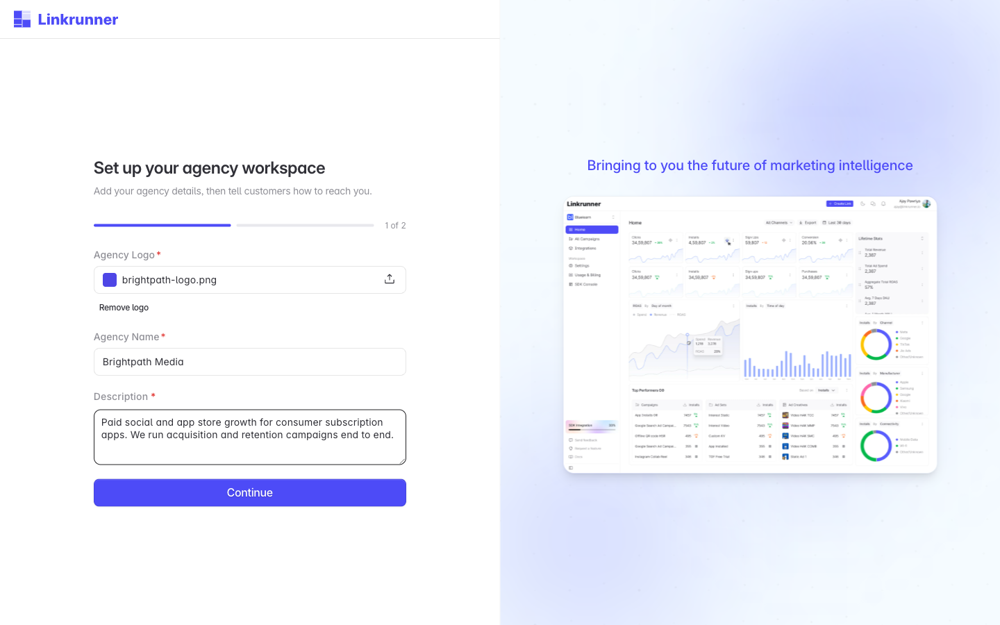
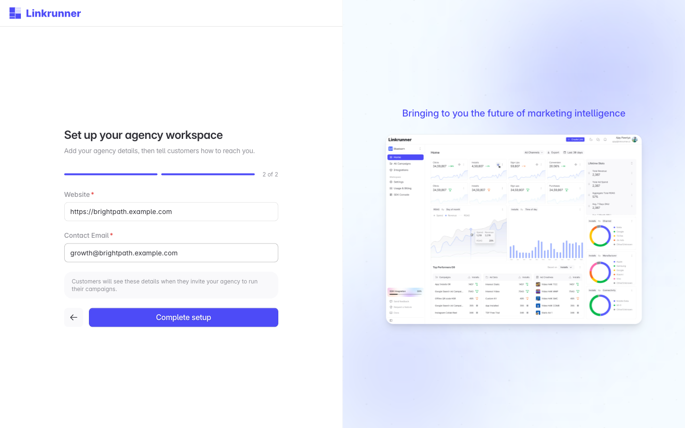
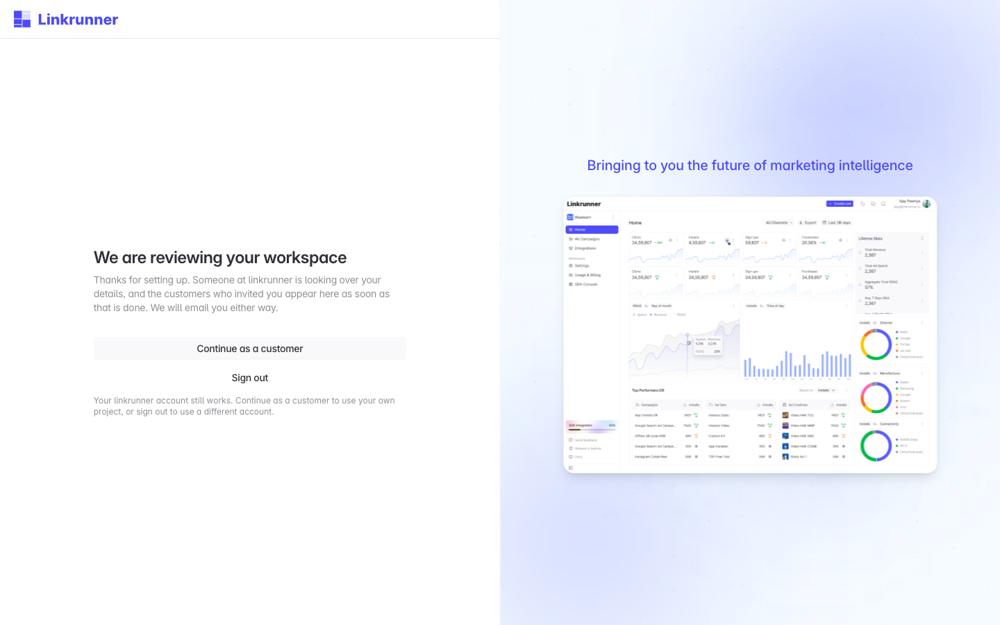

# Create an Agency Account

Sign up as an agency partner, add your agency details, and get your workspace approved so customers can engage you

An agency account gives you one workspace for running campaigns inside the Linkrunner projects of the customers you work with. You can create it yourself. You do not need a customer to invite you first.

<Info>

You need your agency's work email address (personal Gmail addresses are not supported), a logo, your agency name, a short description, your website, and a contact email. You can change all of the details later from **Agency Settings**.

</Info>

<Note>

Got an invitation email from a customer? Use the link in that email instead, so your workspace is connected to that customer. See [Set up your agency workspace](/agency-partners/accept-invitation).

</Note>

## 1. Open the sign up page

Open [Agency Partner Sign Up](https://dashboard.linkrunner.io/agency/signup) and click **Continue**.

If your agency already has a workspace, click **Sign in** instead.

## 2. Sign in with your work email

Choose **Continue with Google**, or enter your **Email address** and click **Send sign-in link**, then open the link sent to your inbox. Use your agency's work email.

The address you sign in with owns the agency workspace. You invite the rest of your team later, from **Agency Settings → Members**.

## 3. Create your agency workspace

After you sign in, you return to the sign up page. It shows the address you are signed in as. Check that it is the right one, then click **Create agency workspace**.

If it is the wrong address, click **Sign out and use another account** and sign in again.

## 4. Add your agency details

<Steps>

<Step title="Upload your logo">

A PNG, JPG, or WebP file up to 5 MB. Customers see it when they pick your agency.

</Step>

<Step title="Name your agency">

The registered name of your company, as customers should recognise it.

</Step>

<Step title="Describe what you do">

At least 20 characters on what your agency specialises in. This appears next to your name in the customer's agency list.

</Step>

<Step title="Continue">

Click **Continue** to move to your contact details.

</Step>

</Steps>

Enter your **Website** and a **Contact email**. Use an address your team monitors, because it is the address customers reach you on. Then click **Complete setup**.

## 5. Wait for review

Linkrunner reviews new agency workspaces. Until that is done, you see the **We are reviewing your workspace** screen.

You can close the page. Linkrunner emails you when the review is done.

## 6. Get engaged by customers

After approval, your agency appears in the agency list customers choose from, under **Settings → Members → Invite Agency** and **Integrations → Agencies** in their project. They can search it by name, description, or website. Tell the customers you work with to look for your agency name there.

Each customer that engages you appears in your workspace. Sign in at [dashboard.linkrunner.io](https://dashboard.linkrunner.io) and pick their project from the project picker. Every later customer lands in this same workspace, so you never set it up again.

Each customer chooses which screens and data you can reach in their project. If a screen shows an access message, ask that customer to grant it. See [Control agency access](/agency-partners/control-agency-access).

## Troubleshooting

**"You already have an agency invitation".**
A customer has already invited your email address as an agency. Open that invitation email and use its link, which keeps your workspace connected to the customer who invited you. See [Set up your agency workspace](/agency-partners/accept-invitation). Its subject reads **"\<Project> has invited you to run their campaigns on Linkrunner"**.

**"Email domain not allowed" or "This email domain is not allowed for registration".**
Your email domain cannot be used for an agency account. Click **Sign out and use another account** and sign in with your agency's work email.

**"New accounts cannot be created from this network" or "Too many new accounts from this network".**
Try again later, or from another connection, for example without a VPN.

**You are signed in with the wrong account.**
Click **Sign out and use another account** before you click **Create agency workspace**. If you already created the workspace with the wrong address, contact <support@linkrunner.io>.

**Continue or Complete setup is disabled.**
Add a logo, an agency name of at least 2 characters, and a description of at least 20 characters. On the second step, enter a full website URL, including `https://`, and a valid contact email.

**Your workspace still says it is being reviewed.**
Linkrunner has not finished the review. You get an email when it is done.

**A customer cannot find your agency in their list.**
The list only shows agencies that Linkrunner has approved. Check that your review is done, and ask the customer to search for your agency name.

**Your application was not approved, or your workspace is suspended.**
Contact <support@linkrunner.io>.

**Need help?** Contact <support@linkrunner.io>
