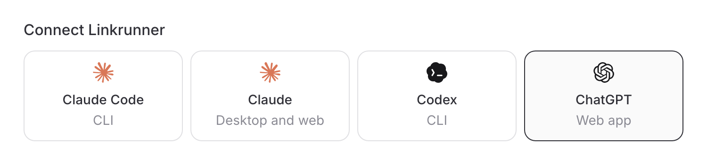

# Set up and use Linkrunner from Claude and other AI assistants

<p class="vp-lead">Connect the Linkrunner MCP server to Claude to set up mobile attribution for your app and ask about your installs and campaigns from a chat.</p>

Add the Linkrunner connector to Claude and you can create your Linkrunner project, get your SDK token, and ask how your campaigns perform, all from a chat. You sign in to Linkrunner in a popup, so there is no token to copy. If you don't have a Linkrunner account yet, you create one in the same popup.

The connector address is:

```text
https://mcp.linkrunner.io/mcp
```

<Note>

Your assistant never changes your project by itself. When you ask for a
change, it proposes it and shows you what will change. Linkrunner applies it
only after a person approves it. See
[Approve changes your AI assistant asks for](/features/mcp-changes).

</Note>

## Connect

Add the connector once. Your assistant asks you to sign in the first time it needs your Linkrunner account.

<Tabs>

<Tab title="Claude">

These steps are the same in Claude on the web, desktop, and mobile.

1. Open **Customize → Connectors**.
2. Select **Add custom connector** and name it `Linkrunner`.
3. Enter `https://mcp.linkrunner.io/mcp` as the URL.
4. Under **Authentication**, choose **Sign in when needed**.
5. Under **OAuth client**, choose **Use Claude's published identity**.

In a chat, select **+ → Connectors** and enable Linkrunner for that
conversation.

The Claude Free plan allows one custom connector.

On Team or Enterprise, an Owner adds the connector under
**Organization settings → Connectors → Add → Custom**. Members then click
**Connect** next to Linkrunner.

</Tab>

<Tab title="Claude Code">

Run this in a terminal:

```bash
claude mcp add --transport http linkrunner https://mcp.linkrunner.io/mcp
```

Then run `/mcp` in Claude Code to sign in. You can also skip this and ask
for something that needs your account. Claude Code asks you to sign in at
that point.

</Tab>

<Tab title="Other MCP clients">

Any MCP client that supports OAuth sign-in can connect. Add
`https://mcp.linkrunner.io/mcp` as a remote MCP server. The server supports
Client ID Metadata Documents and Dynamic Client Registration.

For ChatGPT, use [Connect with a token](#connect-with-a-token-existing-setups-and-chatgpt).

</Tab>

</Tabs>

### What happens when you sign in

You can ask what Linkrunner is, or search the documentation, before you sign in. Any other request needs your account. Claude then shows a **Connect** button in the chat.

1. Click **Connect**. A window opens at `auth.linkrunner.io`.
2. Sign in, or sign up if you are new, with Google or an email link.
3. Review the consent page. It reads "claude.ai wants to access your Linkrunner account", shows the email you signed in with, and lists what the connector can do: see your projects and reports, and create projects and make changes.
4. Approve. The chat continues with your request.

Claude keeps you signed in and refreshes the session automatically. To end the session, disconnect or remove the connector.

## Set up a new app from a chat

Start with a message such as:

> Set up Linkrunner attribution for my app Acme Shop

Your assistant then works through these steps. It asks you to confirm before it creates anything.

<Steps>

<Step title="Check your account">

The assistant calls `get_my_account` to see which email you signed in with
and whether your account can create projects. It then calls
`list_projects` to show any projects you already have.

</Step>

<Step title="Find your app in the store">

The assistant calls `find_app_in_store` to search the App Store or Play
Store by name, or to look up a store link you paste. Confirm which listing
is your app.

</Step>

<Step title="Create the project">

The assistant calls `create_project` with the project name, company, project
type (app or website), store links, report timezone, and optionally the
billing currency (USD or INR). If you already have a Linkrunner billing
account, the assistant asks which one the project belongs to. Check these
details before you confirm. The tool returns the new project ID and your SDK
token.

</Step>

<Step title="Install the SDK">

Add the SDK to your app with that token. The assistant can find the guide
for your platform with `search_documentation`. In a code editor, the
[Linkrunner agent skills](/ai-agent-skills) can make the code changes for
you.

To see the SDK token again later, ask for it. The assistant calls
`get_sdk_configuration`.

</Step>

<Step title="Test the integration">

Follow [Integration testing](/testing/integration-testing) to confirm that
Linkrunner receives installs from your app.

</Step>

</Steps>

After the project exists, every other tool works with it. If you have more than one project, name the project in your question.

### Rules for new projects

These are the same rules the dashboard applies.

- **You need a company email to create a project.** Gmail accounts can sign up and be invited to existing projects, but cannot create one. For help, contact <support@linkrunner.io>.
- **An app project needs a live App Store or Play Store listing.** You cannot set up an app that is not published yet. Come back once its listing is live. A website-only project needs the website URL instead.
- **You can create up to 3 projects per day from an AI assistant.** Only projects you created this way count.
- **To use an existing project, you must be its Admin or Member.** Influencer, finance, partner and agency roles cannot connect.
- **If you already have a billing account, you choose which one the new project uses.** On your first project, a new billing account is created for you.
- New projects get the same free allowance and billing setup as projects you create in the dashboard. See [Billing](/billing/overview).

## What you can ask

Your assistant picks the right tool for your question. Some examples:

- "What is Linkrunner, and does it work with Flutter?"
- "What is my SDK token for Acme Shop?"
- "How did my campaigns perform last week?"
- "Compare my Meta vs Google performance for the last 7 days."
- "Which campaigns should I cut based on ROAS?"
- "Why did installs drop yesterday?"
- "How much of my growth is organic?"
- "What is our D7 and D30 LTV for September installs, and when did they pay back?"
- "Where do users drop off between install and checkout?"
- "Is my iOS link setup right? The link opens the App Store instead of my app."
- "Is Meta receiving my purchase events?"

The assistant can also ask for changes. Each one waits until a person approves it:

- "Create a Meta campaign for the Diwali sale pointing at our sneakers page."
- "Pause the link for the influencer campaign."
- "Save a funnel for install, sign up, then purchase."
- "Set the Google click lookback window to 14 days."

### Built-in prompts

The connector includes three starter prompts. Clients that support MCP prompts
show them in their prompt picker:

- **Daily briefing:** yesterday's performance summary in 1-2 paragraphs.
- **Weekly review:** this week vs last week, with anomalies and a
  keep/cut/scale recommendation list.
- **Cut list:** the worst-performing active campaigns, with reasoning.

These are shortcuts. You can always ask the same questions in your own words.

## Tool reference

This section lists the tools that read. The tools that ask for changes are in
the [AI change tool reference](/features/mcp-tools). Which tools your assistant
sees depends on your connection's permissions and the toolsets you pick (see
[Choose which tools your assistant sees](/features/mcp-tools#choose-which-tools-your-assistant-sees)).
A token with **Read connected ad accounts** also gets 7 read-only
[ad-account tools](#what-the-connector-can-read-from-your-ad-accounts).

Your assistant reads each tool's description and decides which to call. You
don't need to call tools yourself.

On a sign-in connection, every project tool takes the project ID, and the
assistant gets it from `list_projects` or `create_project`. On a
[token connection](#connect-with-a-token-existing-setups-and-chatgpt), the
token decides the project, and the overview and account tools are not offered.

### Before you sign in

| Tool                      | Use it for                                                                                                       |
| ------------------------- | ---------------------------------------------------------------------------------------------------------------- |
| `get_linkrunner_overview` | What Linkrunner is, which SDKs it supports, how setup works through the connector, and what a new project needs. |
| `search_documentation`    | Searches docs.linkrunner.io and returns links and the relevant content.                                          |

### Account and setup

| Tool                    | Use it for                                                                                                              |
| ----------------------- | ----------------------------------------------------------------------------------------------------------------------- |
| `get_my_account`        | The email you signed in with, whether your account can create projects, and the billing accounts a new project can use. |
| `list_projects`         | Your existing projects, with their IDs, store links, and timezones.                                                     |
| `find_app_in_store`     | Search the App Store or Play Store by app name, or look up a store link.                                                |
| `get_sdk_configuration` | The project's SDK token, with links to the dashboard and the SDK docs.                                                  |

`create_project` also belongs to setup. It is listed under [Projects](#projects) because it creates something.

### Project data

| Tool                       | Use it for                                                                                                                                                                                                                                                                  |
| -------------------------- | --------------------------------------------------------------------------------------------------------------------------------------------------------------------------------------------------------------------------------------------------------------------------- |
| `get_project_info`         | Project name, timezone, display currency.                                                                                                                                                                                                                                   |
| `get_project_stats`        | Headline KPIs (clicks, installs, sign-ups, revenue) as lifetime and current-month totals.                                                                                                                                                                                   |
| `get_metrics_trend`        | Day-by-day trend for clicks, organic installs, sign-ups, and revenue. Current calendar month only.                                                                                                                                                                          |
| `list_campaigns`           | One row per campaign, with filters (date range, network, platform, search) and selectable metrics.                                                                                                                                                                          |
| `find_campaign`            | Resolve a campaign name to its `display_id`, with no metrics computed.                                                                                                                                                                                                      |
| `get_campaign_details`     | One named campaign day by day, over any date range.                                                                                                                                                                                                                         |
| `get_channel_performance`  | One row per acquisition channel (Meta, Google, TikTok, Snapchat, Apple Search Ads, Linkrunner Links, Organic).                                                                                                                                                              |
| `get_organic_performance`  | Installs, sign-ups, and revenue carrying no campaign, as a single organic total.                                                                                                                                                                                            |
| `get_cohort_ltv`           | LTV, ROAS, and payback day for a cohort of installs at day-since-install marks (D0, D1, D7, D14, D30 by default), for all installs or only those that did an event, in total or by campaign. A mark the cohort has not reached yet is reported as not reached, not as zero. |
| `list_event_names`         | Custom and revenue event names you've defined.                                                                                                                                                                                                                              |
| `search_event_log`         | Individual event rows with timestamp, user, campaign, platform, and device.                                                                                                                                                                                                 |
| `list_funnels`             | Names and step definitions of the funnels saved in your dashboard.                                                                                                                                                                                                          |
| `run_funnel`               | Step-to-step conversion and drop-off, for a saved funnel or an ad-hoc one you describe in chat.                                                                                                                                                                             |
| `lookup_attribution`       | Attribution result for a single user or device: campaign, ad network, ad set, creative, keyword (Apple Search Ads), organic vs inorganic flag, device IDs (gaid/idfa), and click/install timestamps.                                                                        |
| `get_billing_usage`        | Free-install allowance and current-month usage. Only fetched when you explicitly ask about billing.                                                                                                                                                                         |
| `list_domains`             | Tracking domains on the project, and which one is primary.                                                                                                                                                                                                                  |
| `list_store_listings`      | Custom App Store and Play Store listings you can attach to a campaign.                                                                                                                                                                                                      |
| `list_ad_accounts`         | Ad-network accounts connected to the project.                                                                                                                                                                                                                               |
| `list_postback_event_maps` | Event mappings sent to each ad network, and which are network defaults.                                                                                                                                                                                                     |
| `get_webhook`              | Whether a webhook is configured, its host, and its organic setting.                                                                                                                                                                                                         |

<Note>

`list_campaigns`, `get_channel_performance`, and `get_organic_performance`
return only the metric groups your assistant asks for (installs, spend,
retention, custom events, and so on). A group that wasn't requested is absent
from the response rather than reported as zero, so the assistant never
mistakes "not fetched" for "measured zero". Ask for a metric by name and it
will fetch it.

</Note>

### Setup and delivery checks

| Tool                        | Use it for                                                                                                                                                                                                                                                                   |
| --------------------------- | ---------------------------------------------------------------------------------------------------------------------------------------------------------------------------------------------------------------------------------------------------------------------------- |
| `check_link_setup`          | Checks your iOS and Android link setup: the app details saved in Linkrunner, what your link domains serve at `/.well-known/apple-app-site-association` and `/.well-known/assetlinks.json`, and where a campaign link lands on iOS, Android, and the Facebook in-app browser. |
| `get_postback_delivery_log` | Conversions sent to ad networks and affiliates over the last 7 days by default (up to 30 days): delivered, failed, and not sent, by network and by event, with the network's error messages.                                                                                 |

## What the connector can read from your ad accounts

Ad-account tools are not available on a sign-in connection yet. To use them,
[connect with a token](#connect-with-a-token-existing-setups-and-chatgpt) and
turn on **Read connected ad accounts** when you generate it.

These tools read from the Meta Marketing API and the Google Ads API using the
ad accounts already connected to the project under Settings, and nothing else.
They cannot change anything on Meta or Google.

| Tool                               | Use it for                                                                                                                                                                                                                                                                                                                                                        |
| ---------------------------------- | ----------------------------------------------------------------------------------------------------------------------------------------------------------------------------------------------------------------------------------------------------------------------------------------------------------------------------------------------------------------- |
| `enrich_campaigns_from_ad_network` | Adds the network's delivery figures (spend, impressions, clicks, reach, frequency, CPM) and its own reported outcomes beside your Linkrunner campaigns, with a note explaining any gap between the two.                                                                                                                                                           |
| `get_ad_insights`                  | Spend, impressions, clicks, CTR, CPC, CPM, reach and frequency as the ad network reports them, at account, campaign, ad set or ad group, or ad level, with the network's own conversions under `network_reported`. Optional breakdown by date, device, platform, country, age or gender.                                                                          |
| `list_ad_entities`                 | Campaigns, ad sets or ad groups, ads, creatives, audiences, conversion actions and keywords, with status, budget and objective.                                                                                                                                                                                                                                   |
| `get_ad_entity`                    | Every readable field of one object, such as an ad set's targeting or a campaign's bidding strategy.                                                                                                                                                                                                                                                               |
| `get_ad_recommendations`           | The recommendations Meta shows for one connected Meta ad account, such as creative fatigue or limited budget, plus the account's opportunity score.                                                                                                                                                                                                               |
| `query_ad_network`                 | Anything the tools above cannot express, using the network's own field names: video metrics, impression share, quality rankings, placements, hourly and search-term reports, country, age and gender on Google, attribution-window comparisons on Meta, filters on any field, sorting, and object types such as pixels, labels, saved audiences and asset groups. |
| `ad_network_reference`             | Searches the field catalogs of both networks. Your assistant uses it to find exact names before a `query_ad_network` call, and to explain what a metric means.                                                                                                                                                                                                    |

The catalogs behind these tools come from the networks themselves: Google's
own field schema and Meta's official Marketing API field lists. Every name the
assistant passes is checked against them before a request is made, so it cannot
ask for a field that does not exist. A wrong name comes back with suggestions
instead of a failed call. Almost everything the two reporting APIs expose for
reading is reachable this way.

### Which source answers which question

Linkrunner stays the source of truth, and connecting an ad account does not
change any answer you already get. It adds to them.

| Question                                                                     | Source          | Why                                                                                                      |
| ---------------------------------------------------------------------------- | --------------- | -------------------------------------------------------------------------------------------------------- |
| Installs, reinstalls, sign-ups, events, purchases, revenue                   | Linkrunner      | Attributed per device and per user, deduplicated across networks, and the same numbers as the dashboard. |
| Retention, active users, funnels, attribution detail                         | Linkrunner only | Only Linkrunner has the user-level history.                                                              |
| Cost per install, cost per sign-up, ROAS                                     | Linkrunner      | Synced ad spend divided by Linkrunner outcomes, the same as the dashboard.                               |
| Spend, impressions, clicks, reach, frequency, CTR, CPC, CPM                  | Ad network      | The network bills it, and its live figure is the latest.                                                 |
| Status, budgets, bids, targeting, placements, creatives, audiences, keywords | Ad network only | Only the network knows.                                                                                  |

The network's own conversion counts are still available, but always under a
`network_reported` label. Your assistant quotes them as the network's claim
("Meta reports 12 purchases") rather than as the count. When the two sides
disagree, it explains why (attribution window, view-through, SKAN delay,
cross-network deduplication, or a campaign that is not linked) instead of
picking one.

A few things to know when you read network numbers:

- **They are the ad network's numbers.** Meta and Google count conversions
  with their own attribution windows and view-through rules. Linkrunner's
  installs and sign-ups are measured differently. Your assistant reports the
  two side by side and will not merge them.
- **Currency and timezone come from the ad account**, which may differ from
  your project's display currency.
- **The last three days are provisional.** Networks keep adjusting spend and
  conversions for a few days, so recent numbers can move.
- **Meta has no single "conversions" number.** Your assistant reads the actions
  Meta reports (app installs, purchases, leads and so on) and names the one it
  is quoting.
- **Google's "Conversions" column is not installs.** It adds up every
  conversion action the account bids on (installs, trials, purchases). When
  comparing installs, the assistant uses only Google's install conversion
  actions (the DOWNLOAD category, such as Android first open) and names the
  action it used.
- **Answers may come from a short cache.** Closed date ranges are cached for a
  day, open ranges for ten minutes, and object lists for five minutes. The
  assistant mentions the age when it matters.
- **Reads are budgeted.** Each token gets a daily allowance of live reads, and
  Linkrunner reserves part of its Google Ads quota for attribution. When a
  limit is hit, the assistant gets a wait time and a cached copy if one exists,
  instead of an error loop.
- **Meta connections expire** roughly every 60 days. If your assistant reports that
  the connection has expired, reconnect Meta under Settings.

Only Meta and Google are covered. Accounts on other networks still appear in
`list_ad_accounts` for campaign setup but cannot be queried.

A few Google reports need a specific resource rather than a breakdown. Country
uses `geographic_view`, age and gender use `age_range_view` and `gender_view`,
and search queries use `search_term_view`. The assistant picks these through
`query_ad_network` when you ask.

## What the connector can change

Ask in plain language ("create a campaign for the Diwali sale") and your
assistant picks the right tool. Apart from creating a project, every change
is only a proposal: you see what will change, and Linkrunner applies it only
after a person approves it. The assistant cannot approve for you.

- [Approve changes your AI assistant asks for](/features/mcp-changes) explains
  the approval flow, who can approve, and the switches that turn each type of
  change on or off.
- The [AI change tool reference](/features/mcp-tools) lists every change the
  assistant can ask for: campaigns, links, funnels, cohorts, postbacks,
  attribution settings, integrations, project settings, fraud rules, Signals,
  team, partners, agencies, landing pages, setup and exports.

The sections below cover the changes with side effects you should know about
before you approve.

### Projects

| Tool             | Use it for                                                                                                                                                  |
| ---------------- | ----------------------------------------------------------------------------------------------------------------------------------------------------------- |
| `create_project` | Create a new project in your account and get its project ID and SDK token. Sign-in connections only. See [Rules for new projects](#rules-for-new-projects). |

`create_project` is the one tool that does not wait for approval. Your
assistant asks you to confirm the details first.

### Campaigns

A deep link has to be a full URL on one of your own tracking domains, for
example `https://links.yourbrand.com/product/sneakers`. An external URL is
rejected. Ask your assistant to list your domains if you are not sure which to
use.

Deleting a campaign stops its link working, and it cannot be undone. To stop a
link for now, ask the assistant to pause it instead.

### Funnels

Saving a funnel makes it appear in your dashboard and in `list_funnels` for
everyone in the project. Changing a funnel's steps replaces all of them.

### Domains and store listings

<Warning>

`create_domain` does not check DNS, so it will save a domain that is not pointed
at Linkrunner yet. Check the spelling before you approve. Adding a domain also
creates a permanent `MAIN_DOMAIN` campaign that backs root-domain links and
counts toward your campaign limit, and making the new domain primary changes
which domain later campaigns use by default.

</Warning>

A store listing cannot be deleted while any campaign still points at it. The
assistant names those campaigns. Remove the listing from them first.

### Webhooks

<Warning>

Both webhook tools deliver a real payload to your endpoint when the change is
applied. Saving a webhook sends one by itself, because Linkrunner only stores an
endpoint that answers `200` or `201`, so configuring a Slack webhook posts a
real message to that channel.

Replacing the URL cannot be undone. A project has one webhook, the new URL
overwrites the old one, and the assistant cannot read the old value back to
restore it (`get_webhook` hides the path, because a Slack webhook path is
itself a credential). Keep a copy of the current URL before you approve.

</Warning>

### Postback event mappings

<Warning>

When a new or changed mapping is applied, Linkrunner sends a test postback to
every connected account on that network (Meta, Google, TikTok, Snapchat,
LinkedIn, Reddit). That puts a test conversion in your real ad account, so
avoid repeated edits. The preview lists the accounts that receive it.

</Warning>

An ad network's built-in defaults also appear in `list_postback_event_maps`.
They are always active and cannot be changed or removed. To override one, add
your own mapping for the same event.

## Connect with a token (existing setups and ChatGPT)

Connections made with a dashboard token keep working. Use a token for ChatGPT,
for Codex CLI, or when you need the ad-account tools. A token connection is
fixed to one project.

### Prerequisites

- A project on Linkrunner that you have access to.
- The **Admin** role on that project. Other roles cannot generate MCP tokens.
  Members can connect with [sign-in](#connect) instead.
- A change asked for through the connector runs as the person who approves
  it, using that person's project permissions. See
  [Who can approve](/features/mcp-changes#who-can-approve).

### 1. Generate a token

1. Open the [Linkrunner dashboard](https://dashboard.linkrunner.io) and switch
   to the project you want to connect.
2. Click **MCP** in the sidebar.
3. Choose what the token may do:
   - **Read Linkrunner data** is always on. A new token can only read until
     you tick another option.
   - **Make changes in Linkrunner** lets the assistant ask for changes, such
     as creating and editing campaigns, funnels and postback mappings. Each
     change waits for approval.
   - **Deletes** lets it also ask to delete things.
   - **Team and settings** lets it also ask for team, sharing, webhook and
     project settings changes.
   - **Read connected ad accounts** lets the assistant read your connected
     Meta and Google accounts. See
     [What the connector can read from your ad accounts](#what-the-connector-can-read-from-your-ad-accounts).
4. Click **Generate Token**.
5. The dashboard shows a one-time **Server URL** with the token already
   embedded as a query parameter. Copy it now. The full URL will not be shown
   again.

Capabilities are fixed once a token exists. To change them, generate a new
token and revoke the old one. Tokens created before capabilities existed keep
read and change access, and no ad-account access.

<Warning>

The URL contains the token as a query parameter. Treat it like a password:
don't paste it into shared documents, screenshots, or chat threads. Revoke it
from the dashboard if it leaks, and generate a new one.

</Warning>

### 2. Connect your client

Choose your client in the dashboard to see its setup instructions. The
token is part of the Server URL, so no separate authentication step is needed.



<Tabs>

<Tab title="Claude Code">

Copy the command under **Register the Linkrunner MCP server** and run it in
a terminal:

```bash
claude mcp add linkrunner --scope user --transport http "<YOUR_SERVER_URL>"
```

Start a new Claude Code session and run `/mcp` to verify the connection.

</Tab>

<Tab title="Claude Desktop and web">

These steps work in Claude Desktop and at [claude.ai](https://claude.ai).

On Free, Pro, or Max:

1. Open **Customize → Connectors**.
2. Select **+ → Add custom connector** and name it `Linkrunner`.
3. Paste the Server URL from the dashboard.

On Team or Enterprise, an Owner or Primary Owner first adds the Server URL
under **Organization settings → Connectors**. Members then open
**Customize → Connectors** and connect Linkrunner.

In a chat, select **+ → Connectors** and enable Linkrunner for that
conversation.

See [Anthropic's custom connector guide](https://support.claude.com/en/articles/11175166-get-started-with-custom-connectors-using-remote-mcp)
for current plan and organization details.

</Tab>

<Tab title="Codex CLI">

Copy the command under **Register the Linkrunner MCP server** and run it in
a terminal:

```bash
codex mcp add linkrunner --url "<YOUR_SERVER_URL>"
```

Start a new Codex session and run `/mcp` to verify the connection.

</Tab>

<Tab title="ChatGPT web">

<Warning>

Custom MCP apps currently work in ChatGPT on the web. ChatGPT Desktop is
not supported. Pro apps can use read and fetch tools only. Turn off
**Make changes in Linkrunner** before generating a token on Pro. Full MCP
support, including write tools, is rolling out in beta to Business and
Enterprise/Edu workspaces.

</Warning>

1. Enable Developer mode:
   - On Pro, open **Settings → Apps → Advanced settings**.
   - On Business, an admin or owner enables Developer mode from
     **Workspace settings → Apps → Create**.
   - On Enterprise/Edu, an admin grants access under **Permissions & Roles
     → Connected Data**. Enabled users then turn on Developer mode under
     **Settings → Apps → Advanced settings**.
2. Open **Settings → Apps → Create**. On Business, an admin or owner uses
   **Workspace settings → Apps → Create** instead.
3. Name the app `Linkrunner` and paste the Server URL as the MCP endpoint.
4. Choose no authentication, then select **Scan tools** and **Create**.
5. Test the draft in a new chat. To make it available to workspace members,
   an admin or owner opens **Workspace settings → Apps → Drafts** and
   selects **Publish**.
6. Start a chat, select **Apps**, and choose Linkrunner.

See [OpenAI's MCP apps guide](https://help.openai.com/en/articles/12584461)
for current plan and role requirements.

</Tab>

</Tabs>

<Note>

You only need one connection per client and project. If you manage several
Linkrunner projects, generate a token for each project and add a separate
connection with a clear name. Tokens are scoped to a single project.

</Note>

Open a new chat or CLI session, make sure Linkrunner is enabled, and ask one of
the questions under [What you can ask](#what-you-can-ask).

### Manage tokens

Click **MCP** in the sidebar to see all active tokens for the
project. For each token you can see:

- A masked preview of the token.
- The date it was created.
- The user who created it.
- The last time it was used (helps spot stale tokens).

Each token also shows its capabilities: **Read**, **Changes**, **Deletes**,
**Team and settings**, and **Ad accounts**.

Click the trash icon next to a token to revoke it. Anyone using that token will
be disconnected immediately. Revocation is not reversible. Mint a new token if
you need to reconnect.

A project can have up to 10 active tokens at any time. If you hit the cap,
revoke an unused token before creating a new one.

## Security

### Sign-in connections

- You sign in on `auth.linkrunner.io`. Before the connector gets access, a
  consent page shows which app is asking, the email you signed in with, and
  what the connector can do.
- The connection acts as you. It can use the projects where you are an Admin
  or Member, and it can create new projects in your account.
- It can ask for changes of the **Changes** type, and each one waits for
  approval. It cannot ask for deletes or team and settings changes, and it
  cannot read your ad accounts. Use a token for those.
- To revoke access, disconnect or remove the Linkrunner connector in your
  assistant. That ends the session.

### Token connections

- Tokens are scoped to a single project. They cannot read or change other
  projects you are a member of, even when the same person created the token.
- A change runs only after a person approves it, and it runs as the person
  who approved it, with that person's project role. The connector cannot do
  anything the approver could not do in the dashboard.
- Every applied change is recorded in Change History with who asked for it,
  in which app, and who approved it. Every ad-account read is recorded with
  the account, the query type and the date range, but never the returned
  data.
- Ad-account access is read-only and opt-in per token. The Meta and Google
  credentials stay on Linkrunner's servers; the connector never receives them,
  and they are removed from every response and log.
- An ad-account token can only reach accounts connected to its own project.
  Passing another project's account is refused.
- Tokens are revocable from the dashboard at any time. The per-project cap of
  10 tokens limits the blast radius if one leaks.

<Note>

If you only want someone to read, leave **Make changes in Linkrunner** off when
you generate their token. A read-only token does not even list the tools that
ask for changes, so the assistant cannot propose one. You can also connect to
the [read-only address](/features/mcp-tools#read-only-connection).

</Note>

### Both connection types

- The connector never changes a project by itself. Every change waits for a
  person to approve it, and it can be rejected or left to expire.
- Deletes and team and settings changes are off for every project until a
  project admin turns them on in **Settings → MCP → AI changes**.
- Projects cannot be deleted through the connector.
- The webhook URL is never fully readable. `get_webhook` returns the host but
  hides the path, because a Slack webhook path is a credential in itself.
- Secret values (SDK signing secrets, API keys) are never shown or set through
  the connector, and billing settings are never changed. The assistant gives
  you a dashboard link for those.
- To improve the connector, Linkrunner records basic usage for each call: the
  tool used, whether it worked, how long it took, the names of the arguments
  (not their values), the AI app you use, and the token, project, and person it
  belongs to. Returned data is never recorded.
- Error messages and a short summary of what you asked (your assistant may
  send one with a call) are recorded with emails, links, phone numbers, and
  long IDs hidden. Names and other plain text are kept as written, so avoid
  putting personal or confidential details in your prompts.
- Usage records are kept for one year.

## Troubleshooting

**The assistant says a Gmail account cannot create a project.**
You need a company email to create a project. Gmail accounts can still sign up
and be invited to existing projects. Linkrunner keeps you signed in, so first
sign out: open the [dashboard](https://dashboard.linkrunner.io) and sign out.
Then disconnect Linkrunner in your assistant, connect again, and sign in with
your company email. If you only have a personal email, contact
<support@linkrunner.io>.

**The assistant says your app needs a live store listing.**
An app project needs a published App Store or Play Store listing, and the
assistant will not create a website project in its place. If your app is not
published yet, come back once the listing is live. If the app is published,
paste its store link into the chat so the assistant can look it up directly.

**The assistant says you reached the project limit.**
You can create up to 3 projects per day from an AI assistant. Try again the next
day, or create the project in the [dashboard](https://dashboard.linkrunner.io).

**The assistant says you do not have access to a project.**
A sign-in connection can only use projects where you are an Admin or Member.
Ask an Admin of that project to change your role, then ask again.

**The assistant says a change is waiting for approval.**
That is expected. Open the approve link it gives you, or the approval card if
your AI app shows one. See
[Approve changes your AI assistant asks for](/features/mcp-changes).

**Claude shows Connect again, or Claude Code asks you to sign in.**
The session ended, for example because the connector was disconnected. In
Claude, click **Connect** and sign in. In Claude Code, run `/mcp` and sign in.

**The client says "Couldn't reach the MCP server."**
On a token connection, the token may have been revoked or the URL may be
malformed. Generate a new token, copy the full URL exactly, and reconnect
Linkrunner. On a sign-in connection, check that the URL is
`https://mcp.linkrunner.io/mcp`.

**The client does not show Linkrunner tools.**
Make sure Linkrunner is enabled in the current chat or session. Open the
client's app, tool, or connector menu and turn it on. New chats do not always
inherit connector state from previous chats.

**Numbers don't match the dashboard.**
The connector reads the same data the dashboard does. If you see a mismatch,
check that you and the assistant are using the same project, date range, and
timezone, and that any filters (network, platform) match. Linkrunner's ingestion
is real-time, so there's no lag to account for.

**Generating a token returns "Maximum of 10 active tokens reached."**
You're at the per-project cap. Revoke an unused token from the same settings
page before creating a new one.

**The assistant says your deep link was rejected.**
A deep link has to be a full URL on one of your own tracking domains. An
external address such as `https://example.com/promo` is refused, and so is a
bare path such as `/promo`. Ask the assistant to list your domains and rebuild
the URL on one of them.

**Saving a webhook fails with "Endpoint needs to return a status code of 200".**
Linkrunner only stores an endpoint that answers `200` or `201` to the sample
payload, and it must answer directly rather than redirecting. An endpoint that
returns `202` or `204` cannot be saved.

**The assistant says it cannot read your ad accounts.**
Ad-account tools need a token generated with **Read connected ad accounts**.
Sign-in connections do not offer them yet. Generate a token with that option
turned on and add it as a separate connection. Capabilities cannot be added to
an existing token.

**The assistant says the Meta or Google connection has expired.**
The stored ad-network credential is no longer valid. Open Settings, reconnect
the account, and ask again. Meta connections expire on their own roughly every
60 days.

**The assistant says it has to wait before reading the ad account again.**
A rate limit or daily allowance was reached, either on the ad network or on the
token. The assistant is given a wait time and uses a cached answer when one
exists. Ask again after the wait, or narrow the question so fewer live reads
are needed.

**Ad-network spend does not match the spend Linkrunner shows.**
The two are expected to differ. Ad-account tools return what Meta or Google
report for the ad account, in the account's currency and timezone. Linkrunner's
campaign spend is synced periodically and shown in your display currency. Ask
your assistant for both and it will label which is which.

**The assistant renamed the wrong thing when you asked to rename a channel.**
Ask it to rename the custom channel itself. It looks the channel up with
`list_custom_channels` and proposes `update_custom_channel`.

<Warning>

Asking the assistant to rename a channel by editing the campaign does something
different. It points the campaign at a new channel and leaves the old one
behind, which changes the channel's reporting name and splits its history.

</Warning>

## What this is not

- Not a full write API. The connector can ask for the changes in the
  [AI change tool reference](/features/mcp-tools), and nothing else. Use the
  [Linkrunner data API](/api-reference/data-apis) for programmatic writes.
- Not a way to change things without a person. Every change waits for
  approval.
- Not a way to edit ads. The ad-account tools read from Meta and Google; they
  cannot pause a campaign, change a budget, or edit targeting there.
- Not a generic SQL/Postgres bridge. It calls the same endpoints the
  dashboard uses, with the same access controls.
- Not a substitute for webhooks. Use [webhooks](/features/webhooks) for
  real-time install and signup notifications.

**Need help?** Contact <support@linkrunner.io>
