# Build a remarketing audience

Choose which past users see your remarketing ads by building an audience on Meta or Google.

Before running [remarketing campaigns](/features/remarketing), you need to create audience segments on your ad platform. An audience segment is a group of users the ad platform can target, and it defines who sees your remarketing ads. There are two ways to create one:

| Method | When to use it |
| --- | --- |
| [Upload a customer list](#upload-a-customer-list) | You want to upload a list of customers directly to the ad platform, for example a segment you built in Linkrunner. |
| [Create an audience from tracked events](#create-an-audience-from-tracked-events) | You want to build an audience from events already being sent to the ad platform, such as `Purchase` or `AddToCart`. |

## Upload a customer list {#upload-a-customer-list}

Upload a list of customers directly to the ad platform to create a custom audience for remarketing.

### Prepare your data {#upload-prepare-your-data}

- Create a segment in Linkrunner from Audience Cohort and download the CSV.

### Upload to Meta Ads {#upload-meta}

#### Open the Audiences dashboard

1. Open Meta Ads Manager.
2. Click the **All Tools** menu (the three horizontal lines or "hamburger" icon) on the left sidebar.
3. Select **Audiences**.

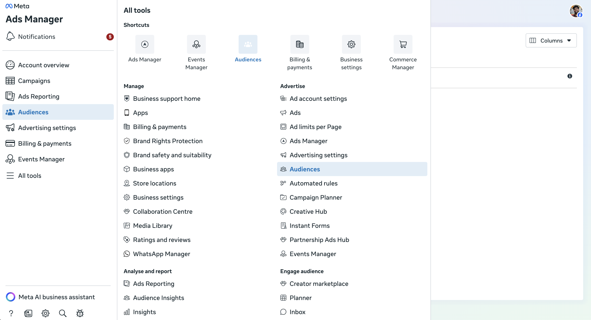

#### Create a Custom Audience

1. Click the blue **Create Audience** dropdown button.
2. Select **Custom Audience**.

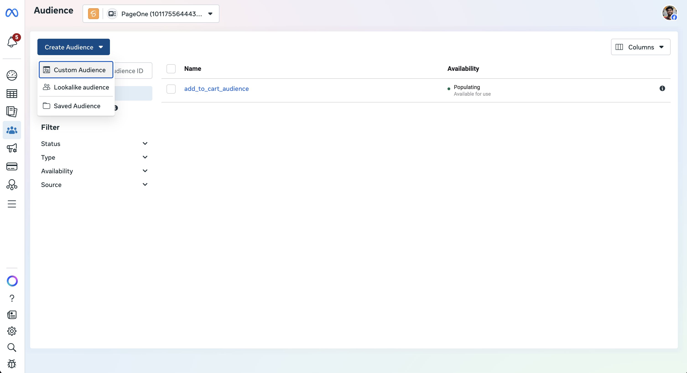

#### Choose your source

1. Under "Your sources," select **Customer list** and click **Next**.

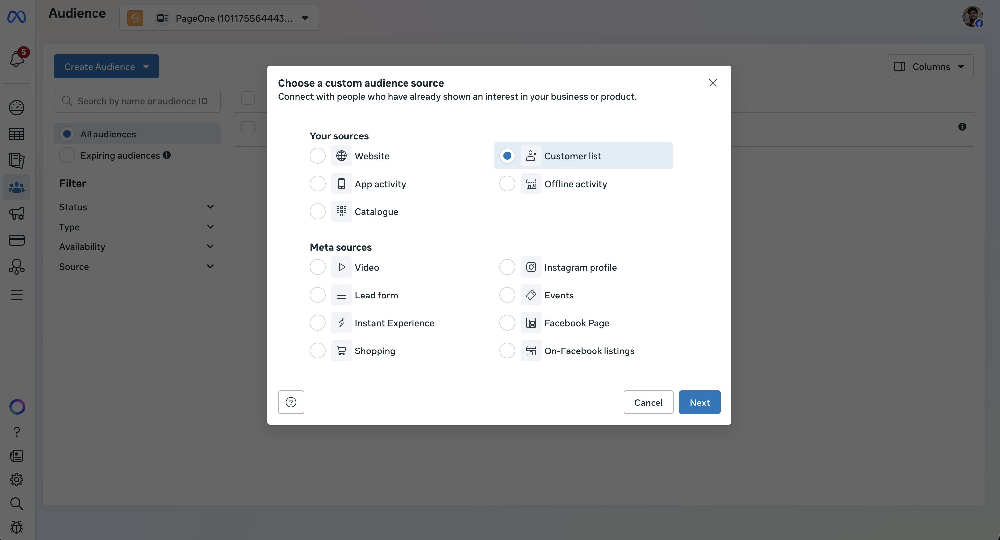

2. **Upload File**: drag and drop your CSV or TXT file, or click to upload it.

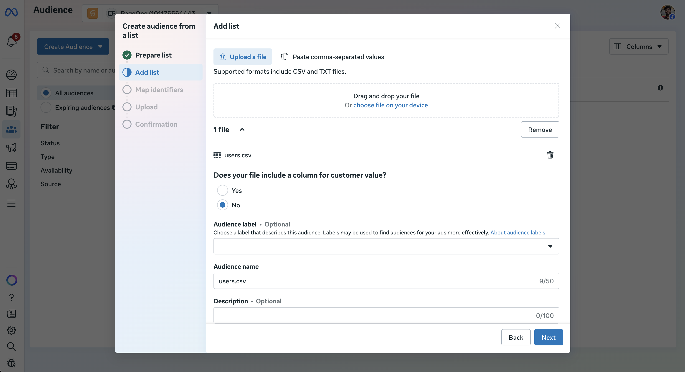

#### Set up your list

1. **Customer Value**: Meta will ask if your list includes a column for customer value. Select **No**, then click **Next**.
2. **Name Your Audience**: give it a clear, descriptive name (for example, "Purchasers - March 2026") and an optional description. Click **Next**.

#### Map your identifiers

Identifiers are the columns Meta uses to match people in your list to Meta accounts, such as email or phone number.

1. Meta will preview your data and try to map your columns to its accepted identifiers.
2. **Action needed**: review the "Mapped" and "Unmapped" tabs. If a column is unmapped, manually select the correct identifier from the dropdown menu, or tell Meta to ignore that column.

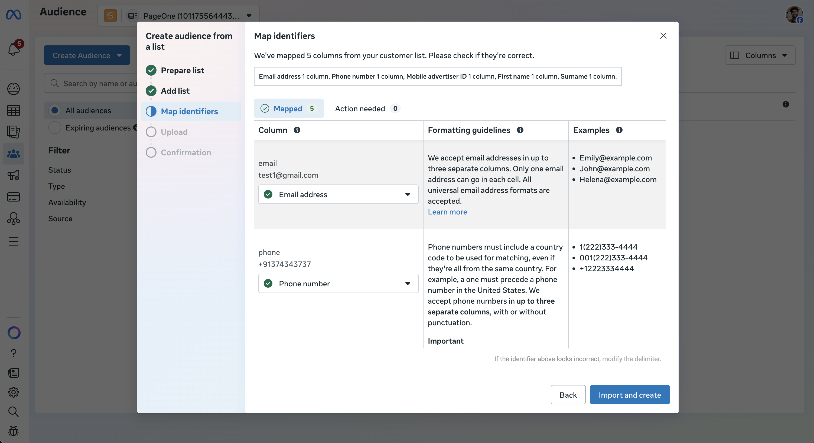

3. Click **Import and Create** to create the audience.

### Upload to Google Ads {#upload-google}

#### Open Audience manager

1. In your Google Ads account, click the **Tools** icon (the wrench) in the left menu.
2. Under the "Shared library" section, click **Audience manager**.

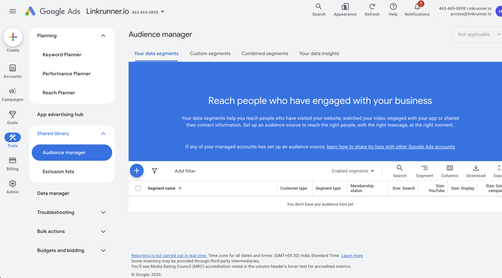

#### Create a new customer list

1. Click the blue **+** button.

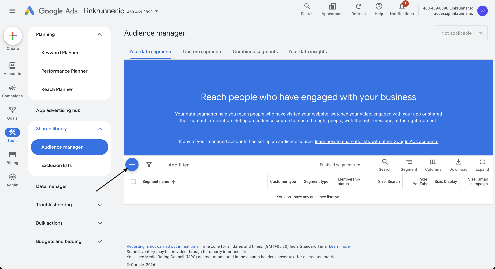

2. Select **Customer list** from the drop-down menu.

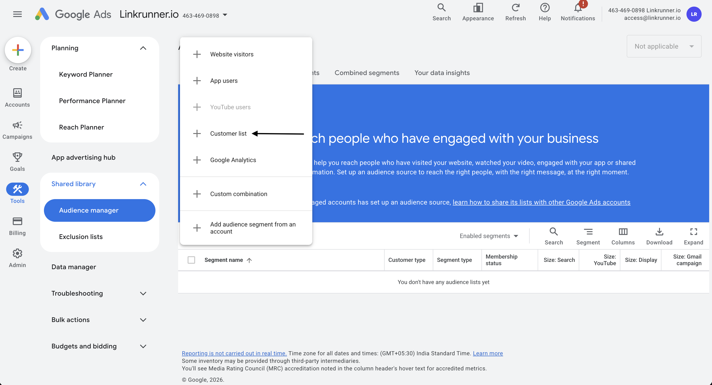

3. Select "Upload a file manually" and click **Continue**.

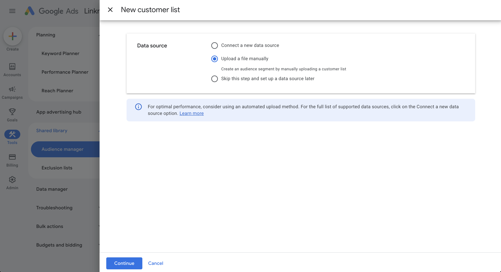

#### Configure the list

- **Segment Name**: give your audience a clear, recognizable name (for example, "Newsletter Subscribers Q1").
- **Data Type**: choose "Upload emails, phones, and/or mailing addresses".
- **Data to upload**: attach your prepared CSV file.
- **Membership Duration**: choose how long you want a user to stay on this list. You can set a specific number of days or choose "No expiration" (the maximum is 540 days).

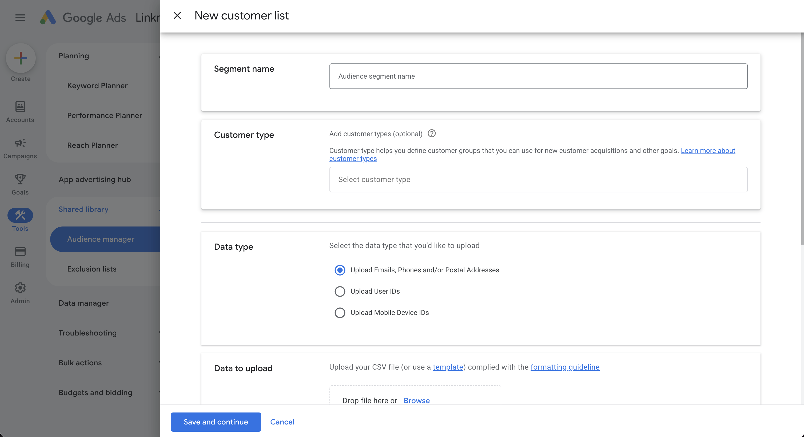

Click **"Save and continue"** to create the customer list.

## Create an audience from tracked events {#create-an-audience-from-tracked-events}

Build audience segments from events that are already being sent to the ad platform.

### Meta {#events-meta}

#### Before you start {#events-meta-before-you-start}

- The event source (Pixel, App, or Offline) is already set up in Meta.
- Relevant events are already being sent through Pixel, SDK, or Conversions API. You can send conversion events via [Linkrunner](/ad-networks/meta-ads) or directly.
- You know which event you want to build the audience from, such as `Purchase`, `AddToCart`, `ViewContent`, `Lead`, or a custom event.

Meta allows audiences to be built from website events, app activity, and other data sources. Custom events set up using Pixel code or Conversions API can also be used to build audiences.

#### Steps {#events-meta-steps}

1. Go to **Audiences** in Meta Ads Manager.

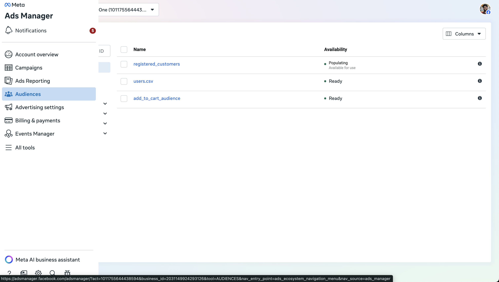

2. Click **Create Audience** and select **Custom Audience**.

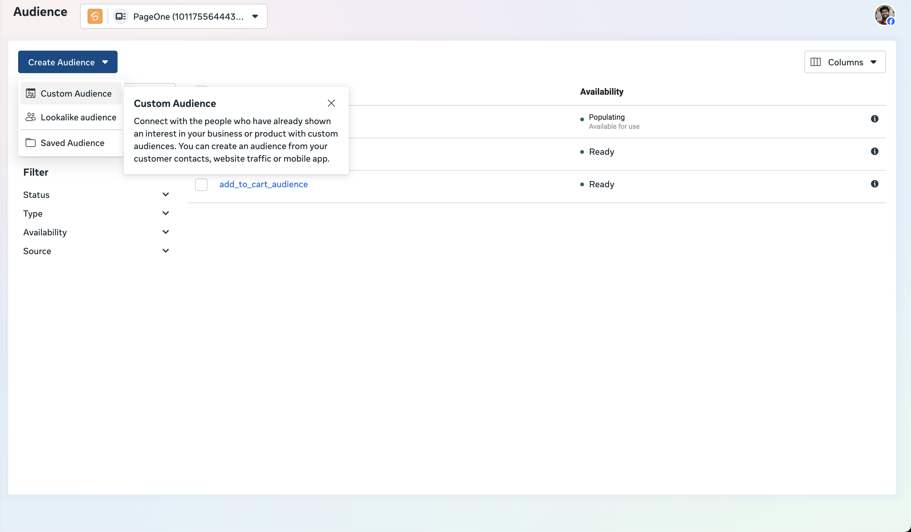

3. Choose the relevant source:
   - **Website** for web events
   - **App activity** for app events
   - **Offline activity** if you are using offline event sets

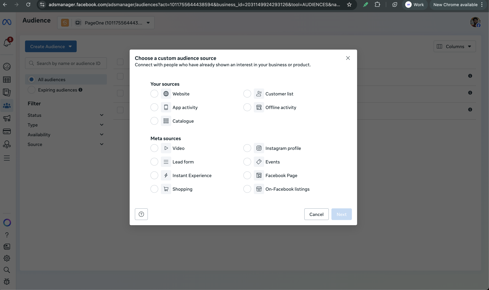

4. Select the correct data source or app.

5. Choose the event rule for the audience:
   - People who triggered specific events
   - People who triggered a custom event already being sent via Pixel or Conversions API

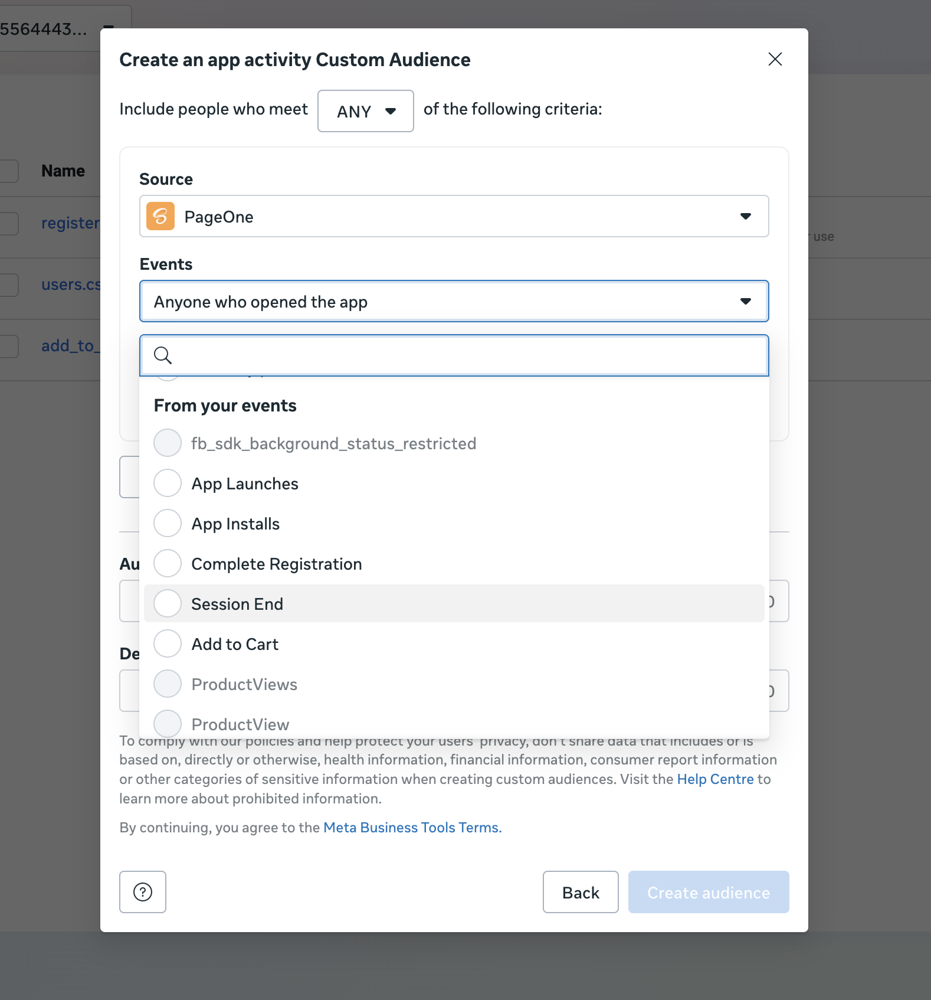

6. Set the retention window (for example, 7, 30, 60, or 180 days). Users are removed from the audience after this period unless they meet the criteria again. The maximum retention window is 180 days.

7. Add inclusion or exclusion rules if needed.

8. Name the audience clearly.

9. Save the audience and wait for it to populate.

### Google {#events-google}

#### Before you start {#events-google-before-you-start}

- Your app or website is linked to your Google Ads account.
- Relevant conversion events are being sent to Google Ads via [Linkrunner](/ad-networks/google-ads) or directly.

#### Steps {#events-google-steps}

1. In Google Ads, go to **Tools > Shared library > Audience manager**.

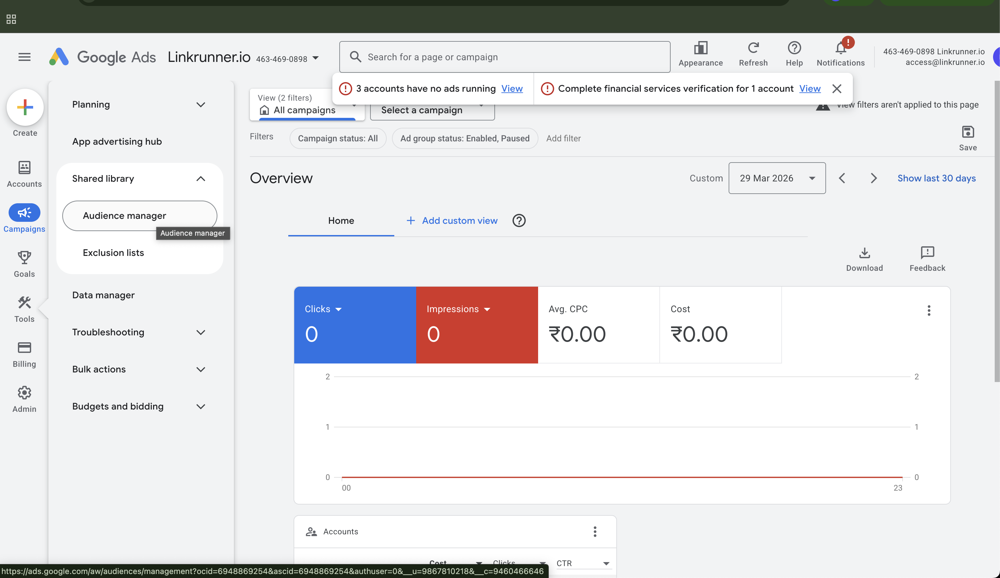

2. Click the **+** icon and select the source: **App Users** or **Website Users**.

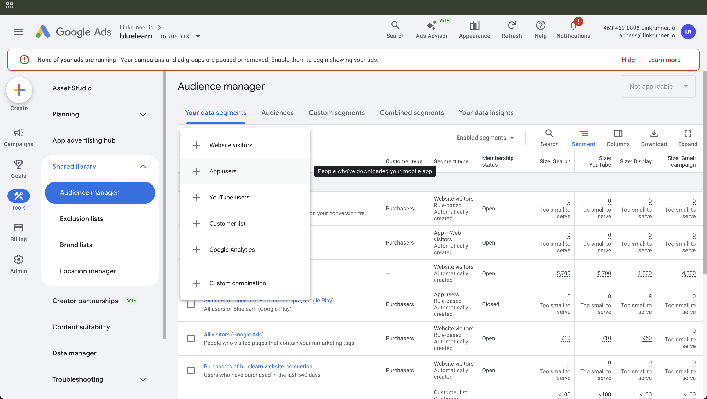

3. Scroll down to the **Actions** section and pick the event.

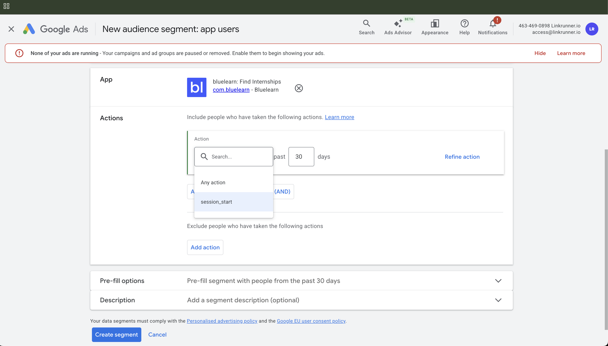

4. Select **Any action** and enter the number of days to include all app users who have been active in that range. The default is 30 days and the maximum is 540 days.

5. Select **Exclude Action** and choose the action name and number of days as required.

6. Repeat the previous step to exclude additional users who took other actions.

7. Name the segment clearly.

8. Save the audience and wait for it to populate.

**Need help?** Contact [support@linkrunner.io](mailto:support@linkrunner.io).
