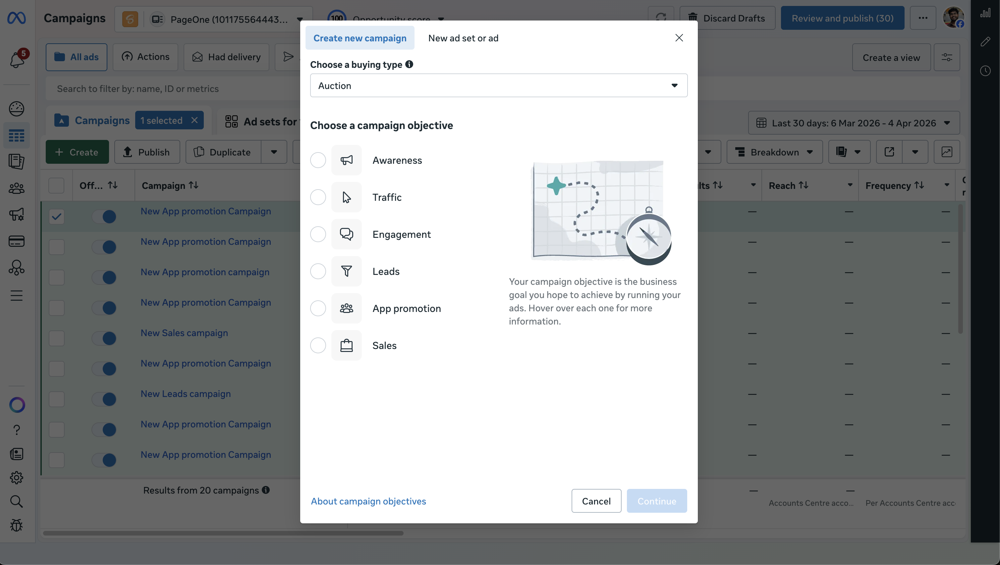
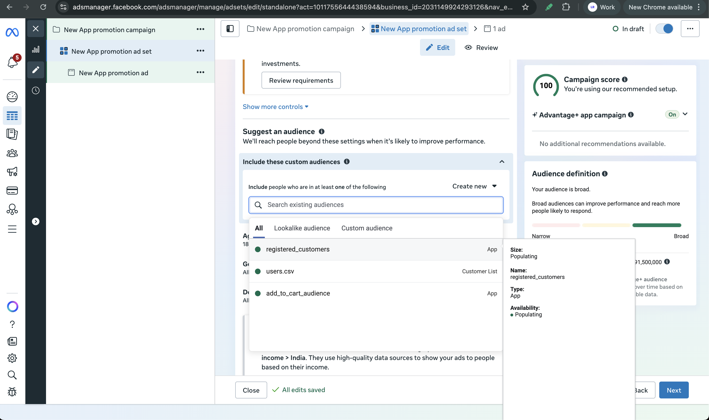
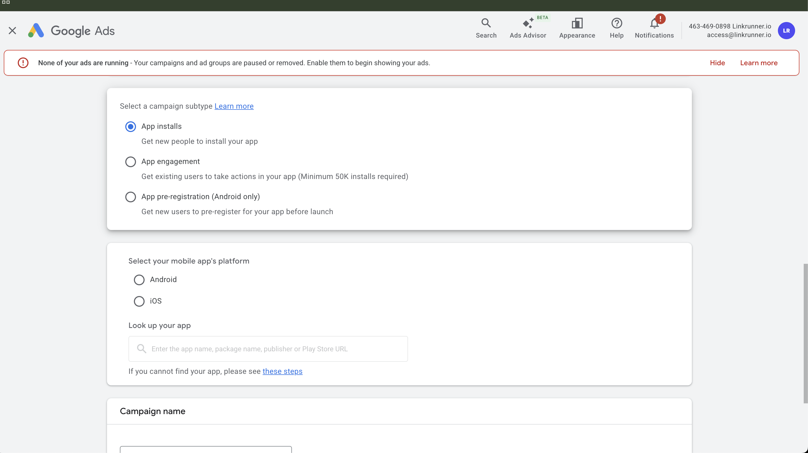
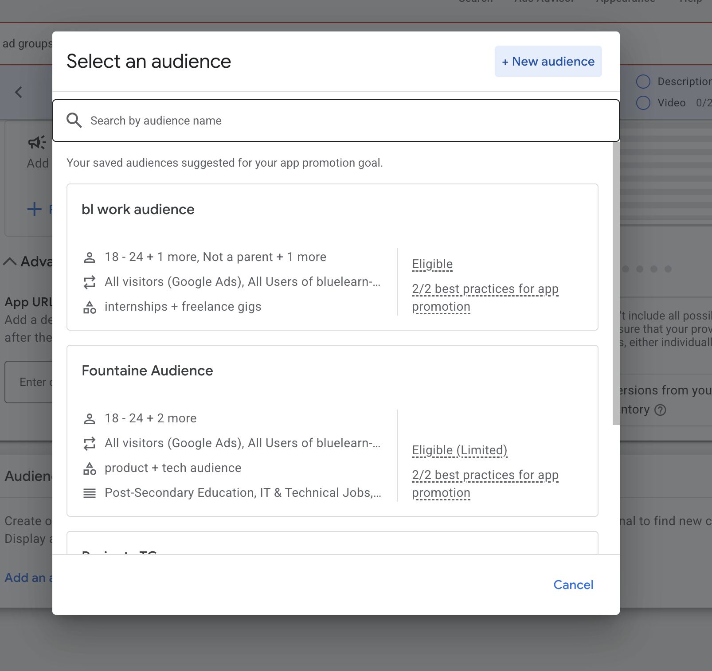

# Run remarketing campaigns

Bring past users back to your app with Meta and Google ads, and see which campaign brought each one back.

Remarketing shows your ads to people who have used your app before, so they come back to it. Linkrunner measures when these existing users return to your app through your campaigns and gives the credit to the campaign that brought them back. This is called **reattribution**: attributing a returning user back to the campaign that brought them back.

## How it works in 4 steps {#how-it-works}

<Steps>

<Step title="Set up your app for reattribution">

Make sure your app is configured for reattribution tracking: deep linking, the `handleDeepLink` function, Android backup configuration, and ATT consent on iOS. See [Set up your app for reattribution](#set-up-your-app).

</Step>

<Step title="Build an audience">

Create an audience segment on Meta or Google, either from a customer list or from tracked events already being sent to the ad platform. See [Build a remarketing audience](/features/remarketing-audiences).

</Step>

<Step title="Launch your remarketing campaign">

Use the audience segment you created to run a remarketing campaign on [Meta](#run-the-campaign-on-meta) or [Google](#run-the-campaign-on-google).

</Step>

<Step title="See which campaign brought users back">

Linkrunner detects returning users through reactivation events and assigns the credit to the right campaign. See [How reattribution works](#how-reattribution-works).

</Step>

</Steps>

## How reattribution works {#how-reattribution-works}

When a user who has already installed your app returns after a period of inactivity, Linkrunner checks whether that return can be attributed to a marketing campaign, meaning whether a campaign should get the credit for it. This is reattribution.

For a user to be reattributed, two conditions must be met:

1. **The user must have been inactive** for at least the configured **inactivity window** (default: 0 days).
2. **The reinstall must occur within the reattribution eligibility window**: the maximum time between an uninstall and a reinstall for the return to count as a reattribution (default: 90 days).

If both conditions are met, the user's return is attributed to the campaign linked to the ad interaction, and a **reengagement** record is created.

### Understanding the windows {#understanding-the-windows}

| Window | What it means | Default |
| --- | --- | --- |
| **Inactivity window** | The minimum number of days a user must be inactive before they can qualify for reattribution. Linkrunner measures inactivity from the **last app open**: the time since the user last opened the app is compared against the configured inactivity window. | 0 days |
| **Reattribution window** (also called the reattribution eligibility window) | The maximum time between an uninstall and a reinstall for the reinstall to count as a reattribution. | 90 days |

**Example:** With a 7-day inactivity window, a user whose last app open was 3 days ago would **not** qualify for reattribution. A user whose last app open was 10 days ago **would** qualify.

### Reattribution triggers {#reattribution-triggers}

A reactivation event is the action a user completes to come back to the app. Reactivation events trigger reattribution and signal a user's return.

Linkrunner supports two reactivation events:

- **App install (reinstall):** the user reinstalls the app after previously uninstalling it. Linkrunner detects reinstalls using device identifiers, the advertising ID each phone has (GAID on Android, IDFA on iOS).
- **Deep link open:** the user clicks a deep link and is taken into the app. For reattribution to work, deep linking must be configured in your app and the `handleDeepLink` function from the Linkrunner SDK must be called when the app opens via a deep link. See the [deep linking setup guide](/features/deep-linking-setup) for configuration details.

### Push notification campaigns {#push-notification-campaigns}

Remarketing campaigns also include push notification campaigns run through engagement platforms like **MoEngage** and **WebEngage**. These campaigns are tracked as remarketing campaigns within Linkrunner.

The flow is similar to a user opening the app via a Linkrunner link: you create a campaign on Linkrunner and use the generated link in a push notification campaign on the engagement platform. When a user opens the app through the push notification link, Linkrunner attributes the return to that campaign.

## See returning users {#see-returning-users}

On the [Campaigns](https://dashboard.linkrunner.io/dashboard/campaigns) page, switch the **Install Attribution** dropdown to **Retargeting**. The Retargeting view shows returning users per campaign, split into two columns:

| Column | What it counts |
| --- | --- |
| **Reinstalls** | Users who reinstalled the app through the campaign. |
| **Reengagements** | Users who already had the app and opened it through the campaign's deep link. |

The [reporting API](/api-reference/reporting-campaigns) returns the same numbers with `view=retargeting`.

## Set up your app for reattribution {#set-up-your-app}

Your app needs the following before Linkrunner can track returning users:

- [Deep linking](/features/deep-linking-setup) must be set up in your app.
- The `handleDeepLink` function from the Linkrunner SDK must be implemented. Refer to your SDK guide ([React Native](/sdk/react-native#handle-deeplink), [Flutter](/sdk/flutter#handle-deeplink), [Android](/sdk/android#handle-deeplink), [iOS](/sdk/ios#handle-deeplink), [Unity](/sdk/unity#handle-deeplinks)) for details.
- Android backup configuration must be set up for reinstall detection on Android. Refer to your SDK guide ([React Native](/sdk/react-native#step-4%3A-android-backup-configuration), [Flutter](/sdk/flutter#backup-configuration), [Android](/sdk/android#step-3%3A-backup-configuration)) for details.

<Note>

On iOS, the user must grant ATT (App Tracking Transparency, Apple's prompt that asks users for permission to track them) for reattribution to work. Without ATT consent, Linkrunner cannot access the IDFA needed to identify returning users.

</Note>

## Run the campaign on Meta {#run-the-campaign-on-meta}

### Before you start {#meta-campaign-before-you-start}

- You have created a [Custom Audience](/features/remarketing-audiences) in Meta Ads Manager.

### Steps {#meta-campaign-steps}

1. Open **Ads Manager** and click **Create**.

2. Select the right campaign objective.

3. Set the campaign name.

4. At the ad set level, scroll to the **Audience** section.

5. Under **Include these custom audiences**, search for and add the custom audiences you created in Audience Manager.

6. Configure the rest of your ad set (placements, budget, schedule) and add your creatives.

7. Review and publish the campaign.

## Run the campaign on Google {#run-the-campaign-on-google}

### Before you start {#google-campaign-before-you-start}

- You have created an [audience segment](/features/remarketing-audiences) in Google Ads Audience Manager.

### Steps {#google-campaign-steps}

1. In Google Ads, click **New campaign**.

2. Pick a campaign goal and subtype.

<Note>

The **App engagement** subtype is only available for apps with 50,000+ installs.

</Note>

3. Select your app platform and choose the app.

4. Set budget, bidding, locations, and campaign dates.

5. At the ad group level, scroll to the **Audience signal** section.

6. Click **Add an audience signal** and select your saved audience list or audience segment.

7. Add creatives and assets.

8. Review campaign settings and launch.

**Need help?** Contact [support@linkrunner.io](mailto:support@linkrunner.io).
